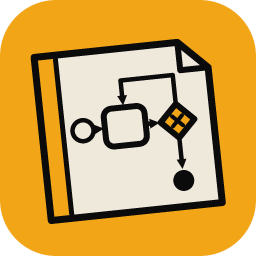
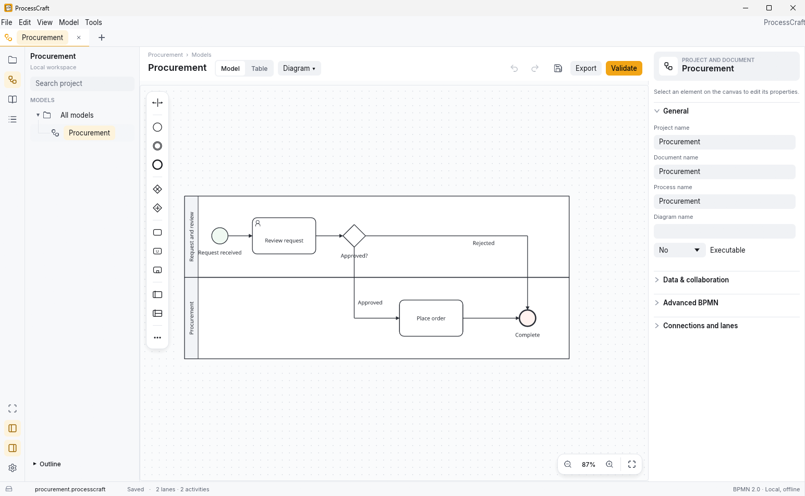
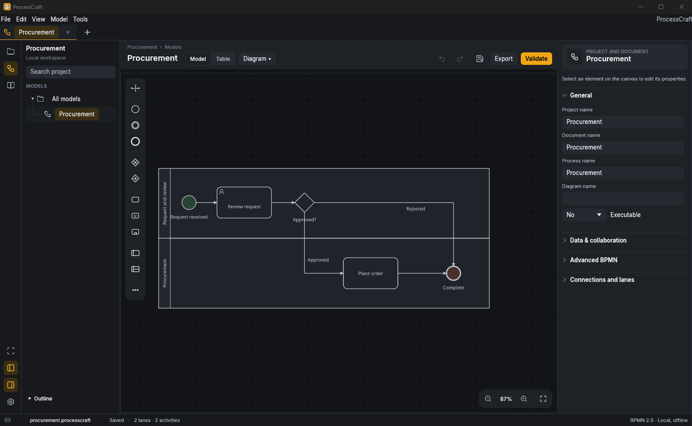
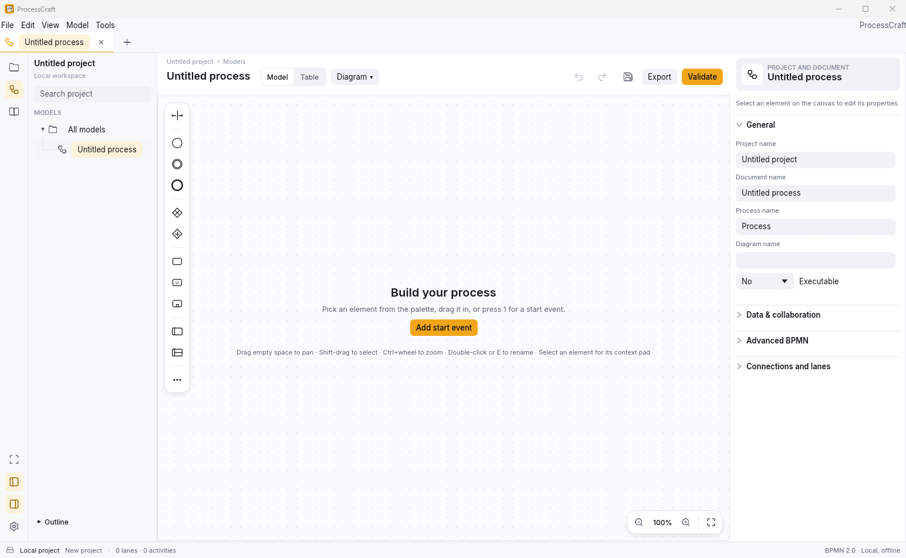
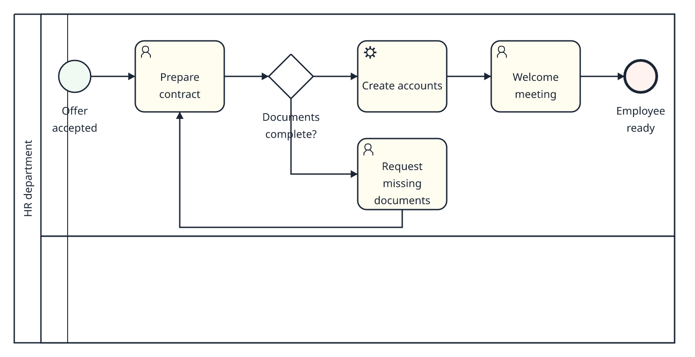
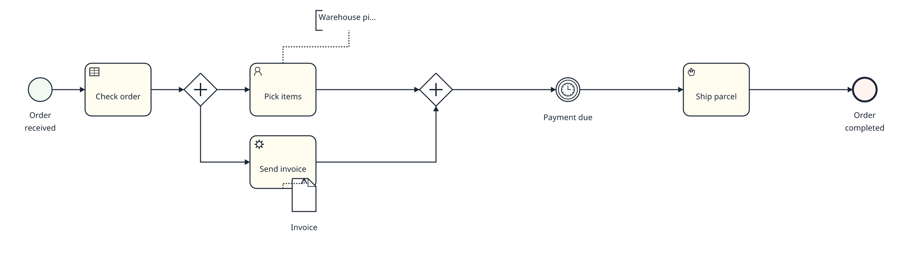
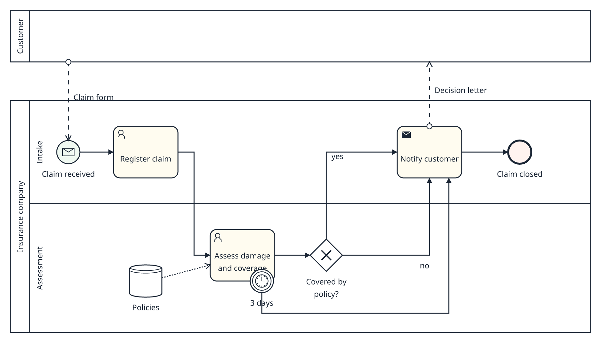
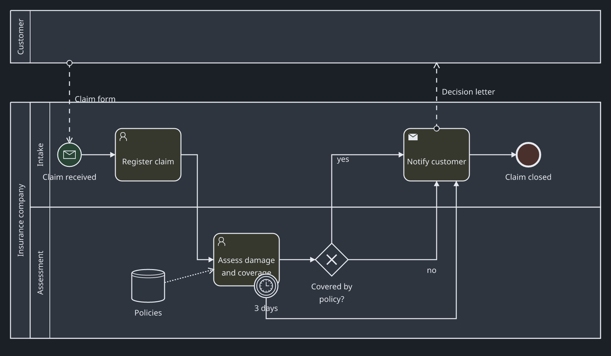

<p align="center">
  
</p>

<h1 align="center">ProcessCraft</h1>

<p align="center">
  <b>BPMN process modeling: offline, native and open source, built in pure Rust.</b>
</p>

<p align="center">
  Draw, analyse and exchange BPMN 2.0 processes in a desktop workbench that opens instantly and
  never needs an account. A modeling canvas in the spirit of bpmn-js, an analyst workbench with
  library, dictionary and activity table, and the same engine available to scripts and AI agents
  through a CLI and an MCP server. Your processes stay in files you own.
</p>

<p align="center">
  
  
  
  
  
  
</p>

<p align="center">
  <a href="#a-look-around">A look around</a> ·
  <a href="#why-processcraft">Why ProcessCraft</a> ·
  <a href="#what-works-today">What works today</a> ·
  <a href="#quick-start">Quick start</a> ·
  <a href="#for-agents-cli-and-mcp">For agents</a> ·
  <a href="#bpmn-interchange">BPMN interchange</a> ·
  <a href="#architecture">Architecture</a> ·
  <a href="#roadmap">Roadmap</a> ·
  <a href="#license-and-credits">License and credits</a>
</p>

> [!NOTE]
> **Pre-alpha (0.1).** ProcessCraft models and exchanges BPMN today, but it has no public release
> yet, the project format may still change, and saving is so far qualified only on Windows (local
> NTFS). [What works today](#what-works-today) says exactly what is and is not verified.

## A look around

<p align="center"></p>
<p align="center"><sub><b>The workbench.</b> A full-bleed canvas with a floating palette and zoom, the document's actions beside its title, and an inspector of collapsible sections.</sub></p>

<table>
<tr>
<td width="50%" valign="top"><p align="center"><sub><b>Dark theme.</b> Every surface, the canvas dots and the BPMN shapes follow the same tokens.</sub></p></td>
<td width="50%" valign="top"><p align="center"><sub><b>A clear first step.</b> Empty views say what to do next; single keys (<code>1</code> <code>T</code> <code>X</code>…) add or append elements.</sub></p></td>
</tr>
</table>

The diagrams below were drawn by ProcessCraft's own renderer — the same scene the canvas shows —
from processes built through the CLI or imported from Camunda Modeler.

<table>
<tr>
<td width="50%" valign="top"><p align="center"><sub><b>Modeling.</b> Built with append, connect and replace: auto-placed elements, Manhattan routing, a rework loop and a pool that wraps its content.</sub></p></td>
<td width="50%" valign="top"><p align="center"><sub><b>Rules that pick the connection.</b> Sequence flows, data associations and annotation links are chosen by the BPMN rules, not by hand.</sub></p></td>
</tr>
<tr>
<td width="50%" valign="top"><p align="center"><sub><b>Interchange.</b> A Camunda Modeler file opens as an editable model; vendor attributes are kept byte-for-byte.</sub></p></td>
<td width="50%" valign="top"><p align="center"><sub><b>Light and dark.</b> Exports to SVG, PNG and PDF in either appearance; SVG text stays searchable.</sub></p></td>
</tr>
</table>

## Why ProcessCraft

- **Familiar modeling.** A context pad next to the selection, drag-to-connect with live
  allowed/forbidden feedback, change-type with `R`, inline labels with `E`, snapping guides,
  bendpoints, lanes and pools, a space tool — the interaction model of bpmn-js, re-implemented
  natively.
- **Correct by construction.** BPMN rules decide what may connect to what and which kind of
  connection to create; an operation that would break the model is refused with a reason instead
  of silently producing an invalid diagram.
- **Honest interchange.** Content outside the supported BPMN profile is preserved byte-for-byte or
  refused — never silently dropped or reinterpreted. Exports validate against the OMG schemas.
- **Built for analysts.** A model library, a project dictionary of roles, systems and documents
  linked to elements, an editable activity table, a problems panel, comments, named checkpoints and
  comparison.
- **Agent-native.** Every change is a typed command. The GUI, the CLI and the MCP server run the
  same commands through the same engine, so a script or an AI agent can do anything the canvas can.
- **Yours.** Native, offline, no account, no telemetry. One portable `.processcraft` file per
  project, with atomic saves, crash recovery and undo for every change.

## What works today

| Area | Highlights |
|---|---|
| **Canvas** | Context pad (append task, gateway, intermediate/end event, annotation; connect; change type; delete), drag or click-to-connect with green/red rule feedback, auto-place, Manhattan routing with BPMN preferred layouts, pan/zoom, box select |
| **Editing** | Change type (`R`) across tasks, events, gateways, sub-processes and data, inline labels and annotation text (`E`), resize where BPMN allows it, snapping guides and 10 px grid, bendpoints and segment drag, reconnect flow ends |
| **Structure** | Boundary events that follow their activity, attach/detach by dropping on an activity border, drop an element on a flow to insert it, lanes (add, split, resize, delete), auto-growing pools and sub-processes, collapse/expand, space tool (`S`) |
| **Productivity** | Copy, cut, paste and duplicate with fresh IDs, select all, align and distribute, canvas search (`Ctrl+F`), auto-layout of a whole diagram with preview, undo/redo for everything |
| **Analyst workbench** | Model library with folders and search, project dictionary with usages, activity table, problems panel, comments, checkpoints, reference comparison and restore |
| **Interchange** | BPMN 2.0 XML import/export with DI; typical Camunda Modeler and bpmn.io files open editable; SVG, PNG and PDF export |
| **Automation** | `processcraft-cli` (batches, queries, validation, import/export, images, layout) and a local MCP server, standalone or attached to the open desktop session |

Verified by about 1,100 automated tests and three quality gates (format, Clippy with warnings as
errors, the full test suite). Not yet qualified: macOS and Linux, screen-reader support for the
canvas, and formal performance targets on large models — see the [roadmap](#roadmap).

## Quick start

You need **Rust 1.98.1** (installed automatically by [rustup](https://rustup.rs) from
`rust-toolchain.toml`) and **Git**. The first build fetches pinned forks of
[egui](https://github.com/storytold/egui), [winit](https://github.com/storytold/winit) and
[craft-libs](https://github.com/storytold/craft-libs); after that everything builds offline.

```sh
cargo run --release -p processcraft                  # desktop app
cargo run --release -p processcraft -- model.bpmn    # open a project or import a BPMN file
cargo run --release -p processcraft-cli -- --help    # command-line tool
```

### Shortcuts

| Action | How |
|---|---|
| Add an element | Click an entry of the floating palette (auto-placed and connected to the selection), or drag it onto the canvas |
| Element keys | `1` `2` `3` start, intermediate and end event · `T` task · `U` user task · `B` subprocess · `X` `P` exclusive and parallel gateway · `N` annotation (appended to a single selected shape) |
| Append, connect, change type, delete | The context pad next to the selection · `C` connect · `R` · `Del` |
| Rename / edit annotation text | Double-click or `E` (`Ctrl+Enter` finishes multi-line text) |
| Change type | `R` |
| Pan / zoom | Drag empty canvas, middle mouse or `Space`+drag · `Ctrl`+wheel · `Ctrl` `+` `−` `0` |
| Select | Click · `Shift`+click to toggle · `Shift`+drag for a box · `Ctrl+A` |
| Move precisely | Arrow keys (1 px), `Shift`+arrows (10 px); hold `Alt` to drag without snapping |
| Clipboard | `Ctrl+C` `Ctrl+X` `Ctrl+V` `Ctrl+D`; pasting BPMN XML from another tool imports it |
| Find · space tool | `Ctrl+F` · `S` |
| Undo / redo · save / open / new | `Ctrl+Z` / `Ctrl+Y` · `Ctrl+S` / `Ctrl+O` / `Ctrl+N` |
| Focus mode · bottom panel | `Ctrl+.` · `Ctrl+J` (Problems, Comments, Revisions) |

Properties of the selected element live in the **Properties** panel and apply when you press Enter
or leave a field; rarely used BPMN and XML details sit under **Advanced BPMN**.

## For agents: CLI and MCP

`processcraft-cli` runs exactly the commands the canvas runs. A batch is a JSON list of typed
mutations, applied atomically as one undo step.

```sh
processcraft-cli commands --json                     # every command + JSON Schema of the protocol
processcraft-cli run --new Procurement --batch tests/fixtures/commands/procurement.json --out procurement.processcraft
processcraft-cli info procurement.processcraft       # documents and diagram IDs
processcraft-cli validate procurement.processcraft --json
processcraft-cli query procurement.processcraft replace-options <document-id> <element-id>
processcraft-cli import-bpmn diagram.bpmn --out diagram.processcraft
processcraft-cli export-bpmn diagram.processcraft --document-id <id> --out diagram.bpmn
processcraft-cli export-image diagram.processcraft --document-id <id> --diagram-id <id> --format svg --out diagram.svg
processcraft-cli export-drawio diagram.processcraft --document-id <id> --diagram-id <id> --out diagram.drawio
```

The modeling operations — `append`, `connect`, `createAt`, `replaceElement`, `moveElements`,
`resizeShape`, `reconnect`, `addLane`, `splitLane`, `createPool`, `toggleCollapse`, `makeSpace`,
`align`, `distribute`, `duplicate` — are batch commands too.

```sh
# MCP, standalone: the agent works on a file, inside folders you allow
processcraft-cli mcp --in project.processcraft --read-root C:\models --write-root C:\models\out

# MCP, attached: the agent edits the project open in the desktop app (Enable attachment)
processcraft-cli mcp --attach <endpoint> --session <session> --token <token>
```

Nothing listens by default; attachment is switched on from the desktop app, which shows the
endpoint, session and token, and file access is limited to folders you authorize.

Four ready-made agent instructions (text to model, review conventions, explain a process, fill
attributes) live in [docs/prompts](docs/prompts/README.md). Their examples are checked against the
live schemas and their recorded runs are replayed in CI.

## BPMN interchange

| Import mode | Meaning |
|---|---|
| **Editable** | The model fits the supported profile and is fully editable. |
| **Editable with retained extensions** | Vendor extensions are kept verbatim. Vendor *attributes* (e.g. `camunda:assignee`) do not restrict modeling, but an element they reference by ID cannot be deleted; unmodeled vendor *elements* block structural edits that could invalidate them. |
| **Preserved source** | The original XML is kept byte-for-byte and exported unchanged; the import report names what prevented editing. |

Parsing is bounded, rejects DTDs and external entities, and never loads remote resources. Coverage
is tracked element by element in [`docs/research/bpmn-2-coverage.md`](docs/research/bpmn-2-coverage.md);
this is a broad, tested profile, not a claim of complete BPMN 2.0.2 coverage or OMG conformance.

A project is one `.processcraft` file: a ZIP package of versioned JSON and resources holding BPMN
documents and diagrams, the dictionary, folders, comments and checkpoints. Saves are atomic, a
sidecar lock prevents two writers, and recovery snapshots live outside the project.

## Architecture

```text
apps/processcraft      desktop app (egui)  ─┐
apps/processcraft-cli  CLI + MCP server     ─┼─▶ processcraft-io ─────┐
                                             └─▶ processcraft-render ─┴─▶ processcraft-core
```

| Crate | Job |
|---|---|
| `processcraft-core` | Domain model, typed commands with undo/redo, BPMN modeling rules (`rules`, `modeling`, `replace`, `manipulate`, `containers`, `clipboard`, `arrange`), validation, queries, geometry, routing and auto-layout. No file system, UI or network. |
| `processcraft-io` | The `.processcraft` format, BPMN XML import/export, atomic save, recovery, file grants, settings, local IPC. |
| `processcraft-render` | Toolkit-free scene, text layout with bundled fonts, CPU rasterizer, SVG/PNG/PDF export. |
| `processcraft` | Desktop composition: canvas gestures, context pad, panels, menus, background jobs. |
| `processcraft-cli` | CLI parsing, JSON batches, MCP server. |

Every persistent change goes through one command pipeline (`processcraft_core::commands::Session`);
the GUI holds no BPMN semantics of its own. The full design and its rationale are in
[`docs/design/solution-design.md`](docs/design/solution-design.md).

### Developing

```sh
cargo fmt --all -- --check
cargo clippy --workspace --all-targets --all-features --locked --offline -- -D warnings
cargo test --workspace --all-targets --all-features --locked --offline
```

All three must pass. Fixtures in `tests/fixtures/` and fonts in `assets/fonts/` are pinned
byte-for-byte with recorded SHA-256 hashes: never re-save them, and give new fixtures a manifest
entry. `unsafe` code is forbidden except in three reviewed Windows adapters. The Python scripts in
`scripts/` cross-check BPMN output against the pinned OMG schemas (they need `lxml`, `pypdf`,
`Pillow` and Poppler).

## Roadmap

- **M4 — desktop alpha:** Windows installer and file association, keyboard and screen-reader
  (Narrator) qualification of every view, measured performance on medium and large models, a
  documented capability matrix.
- **Interchange:** independent re-opening of exported files in other BPMN tools, broader coverage
  of vendor extension elements.
- **Platforms:** macOS and Linux once dialogs, file locking, fonts and paths are qualified there.

Plans live in [`docs/plans/`](docs/plans/); what was actually verified, with measured limits, is
recorded in [`docs/implementation/`](docs/implementation/).

## Contributing

Contributions are welcome. Open an issue first for larger changes — especially anything touching
the project format or BPMN interchange. Keep BPMN behavior in `processcraft-core` behind the command
pipeline so the GUI, CLI and MCP stay consistent, add focused tests, make the three gates pass, and
record what you verified in `docs/implementation/`. Please report security issues privately.

## License and credits

ProcessCraft is released under the [MIT License](LICENSE). The app icon is original artwork for
this project, under the same license ([details](assets/app-icon/README.md)).

Third-party material keeps its own license:

- **Noto Sans** fonts in [`assets/fonts/`](assets/fonts/): SIL Open Font License 1.1
  ([attribution](assets/fonts/ATTRIBUTION.md)).
- **Lucide** icons in the design prototype: ISC License
  ([`design/assets/lucide/LICENSE`](design/assets/lucide/LICENSE)).
- **OMG BPMN 2.0.2 schemas** in [`tests/fixtures/bpmn20-schema/`](tests/fixtures/bpmn20-schema/):
  © Object Management Group, included unmodified only to verify import and export.
- Rust dependencies are fetched by Cargo under their own licenses.

ProcessCraft builds on [craft-libs](https://github.com/storytold/craft-libs) and the egui/winit
forks of the open-source Crafting Apps, and its modeling interactions follow the behavior of
[bpmn-js](https://github.com/bpmn-io/bpmn-js) by bpmn.io. It is an independent project: it contains
no bpmn-js code and is not made, sponsored or endorsed by the ArtCraft team or bpmn.io. BPMN is a
standard of the [Object Management Group](https://www.omg.org/spec/BPMN/2.0.2/).
