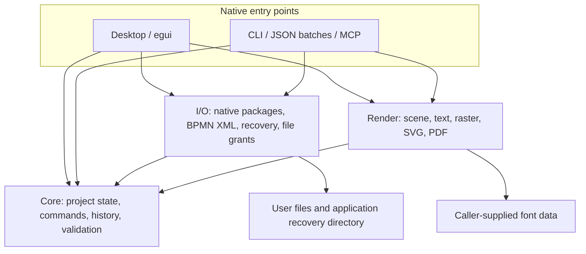
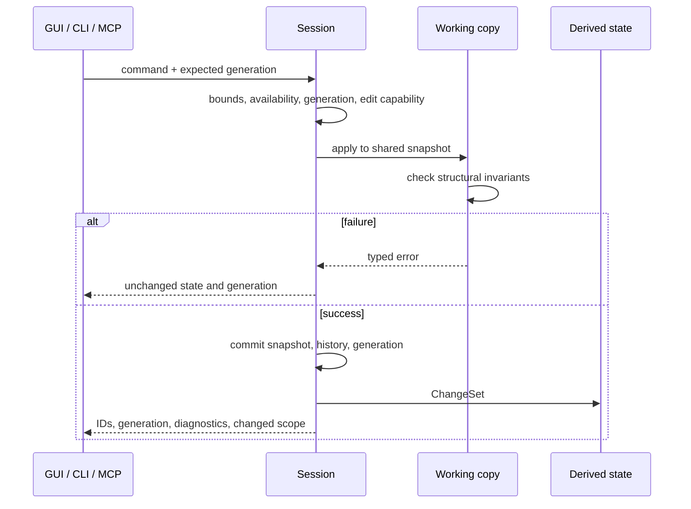

# ProcessCraft — Architectural Solution Design

**Date:** November 11, 2026  
**Status:** accepted architectural baseline; M0/M1 and M2 Tasks 01–23 are implemented and reviewed within the [M2 qualification boundaries](../implementation/m2-evidence.md). Four views, qualified flat BPMN interchange, SVG/PNG and explicitly authorized local automation are implemented. Medium save latency now meets its measured target; rename latency remains explicitly above budget. M3 has a temporary partial delivery at the user's request, recorded in the [M3 evidence](../implementation/m3-evidence.md). Its full BPMN scope, M4 and broader platform/interoperability qualification remain unfinished.

**M3 scope amendment (November 11, 2026):** The user approved extending M3 to full BPMN 2.0.2 modeling/interchange, including advanced process metadata, conversation and choreography. This supersedes earlier deferrals below. The offline analyst workbench does not include a workflow execution server. The [expanded M3 plan](../plans/m3-implementation-plan.md) and [coverage baseline](../research/bpmn-2-coverage.md) govern delivery; M3 remains in progress and no full-conformance claim is currently justified.

**Product:** an offline desktop workbench for process analysts, implemented in Rust.  
**Design reference:** [editable workbench](../../design/ProcessCraft.figcraft), [eight boards](../../design/ProcessCraft-boards.pdf).  
**Language:** English for product copy, source identifiers, documentation, and automation contracts.

## Contents

1. [Decision and scope](#1-decision-and-scope)
2. [What the other Craft applications actually do](#2-what-the-other-craft-applications-actually-do)
3. [Options and architectural decisions](#3-options-and-architectural-decisions)
4. [System boundaries and workspace](#4-system-boundaries-and-workspace)
5. [Domain model and invariants](#5-domain-model-and-invariants)
6. [BPMN support and preservation contract](#6-bpmn-support-and-preservation-contract)
7. [Commands, transactions, and undo](#7-commands-transactions-and-undo)
8. [Native project format](#8-native-project-format)
9. [Saving, conflicts, and recovery](#9-saving-conflicts-and-recovery)
10. [Dictionary and revision semantics](#10-dictionary-and-revision-semantics)
11. [Table view](#11-table-view)
12. [Geometry, routing, and layout](#12-geometry-routing-and-layout)
13. [Rendering, fonts, and export](#13-rendering-fonts-and-export)
14. [Desktop UI and accessibility](#14-desktop-ui-and-accessibility)
15. [Concurrency and jobs](#15-concurrency-and-jobs)
16. [CLI, MCP, and local control](#16-cli-mcp-and-local-control)
17. [Trust boundaries and resource limits](#17-trust-boundaries-and-resource-limits)
18. [Dependencies and reuse](#18-dependencies-and-reuse)
19. [Performance targets](#19-performance-targets)
20. [Verification and interoperability](#20-verification-and-interoperability)
21. [Delivery sequence](#21-delivery-sequence)
22. [Risks and decision gates](#22-risks-and-decision-gates)
23. [Traceability to the approved screens](#23-traceability-to-the-approved-screens)
24. [Evidence and source revisions](#24-evidence-and-source-revisions)
25. [Review and implementation readiness](#25-review-and-implementation-readiness)

## 1. Decision and scope

Build one native desktop application around a toolkit-independent process engine. The GUI, CLI, and MCP adapter use that engine's typed operations. A portable `.processcraft` package is the unit of persistent consistency: models, dictionary references, and named checkpoints are saved together.

The first release is an **analyst workbench**. It supports documenting and reviewing processes, not executing business operations. BPMN describes work; ProcessCraft does not run purchase orders, scripts, service tasks, expressions, or external connectors.

The approved surfaces are the BPMN editor, process library, project dictionary, and synchronized table view, each in light and dark themes. All four are views over the same project state. There is no separate table document, dictionary database, or diagram JSON owned by the UI.

### 1.1 Fixed requirements

| ID | Requirement | Architectural consequence |
|---|---|---|
| R01 | Native Rust desktop | egui/eframe; no Electron, Tauri, browser shell, or production JavaScript |
| R02 | Offline core workflows | create, open, edit, validate, save, recover, and export without accounts or a server |
| R03 | Signavio-inspired analyst workflow | library, reusable dictionary, attributes, revisions, and table projection surround BPMN editing |
| R04 | One editable model | canvas, inspector, table, validation, and automation share stable identifiers |
| R05 | File ownership | project can be copied and backed up as a user-visible file |
| R06 | No silent data loss | explicit preservation modes, atomic replacement, conflict detection, recovery |
| R07 | Agent-ready | typed commands, discovery, inspection, bounded batches, CLI and opt-in stdio MCP |
| R08 | English interface | English labels and diagnostics; user-authored process data remains Unicode |
| R09 | Light and dark | semantic UI tokens; presentation preferences do not alter process semantics |
| R10 | Professional verification | independent import/export checks, failure injection, keyboard and accessibility checks |

Application and domain code are Rust. SQLite is an acceptable dependency if a concrete internal-storage need justifies it; its C implementation is not a reason to exclude it. Permission to use SQLite does not select it as the native document format. The portable package remains the proposed project format.

### 1.2 Initial exclusions

No process execution engine, process mining, distributed repository, authenticated approvals, real-time collaboration, scripting language, plugin marketplace, cloud synchronization, generative AI provider, or full DMN editor.

DMN and richer notations can become separately specified document kinds later. They do not enter the first BPMN schema through speculative generic abstractions. Standalone BPMN validation does not imply executable-model compatibility with a particular workflow engine.

The FigCraft assets are a visual specification. The checkout now contains the M0 Rust workspace: core identities, a native shell, the I/O proofs, and shared text/rendering. The editable process engine and analyst workflows remain later tasks. [M0 evidence](../implementation/m0-evidence.md).

## 2. What the other Craft applications actually do

This comparison uses public source and architectural documentation, including the concrete files linked below. It distinguishes observed implementation from the proposed ProcessCraft choice. The repositories were read at the revisions recorded in section 24; their README readiness figures are not independent benchmarks and are not used as delivery estimates.

### 2.1 Comparative findings

| Application | Observed architecture | Useful lesson for ProcessCraft | Domain-specific machinery to leave behind |
|---|---|---|---|
| **FigCraft** | Separate document, layout, render, format, engine, UI, and automation layers. UI and automation dispatch the same command IDs. Its native format is a ZIP containing JSON and resources. | Shared engine operations, stable document identities, explicit format adapters, toolkit-independent rendering. | Figma scene graph, component propagation, prototype runtime, and collaboration implementation. |
| **PhotoCraft** | `DocState` separates persistent document data, selection, history, view revisions, damage, and save state. The wider application has both CPU and GPU compositors. | Separate content generation from view state; invalidate only what changed; make imports with restricted write capabilities explicit. | Sparse raster tiles, pixel-depth processing, filters, and two compositors at initial scope. |
| **VectorCraft** | History stores shared document and selection snapshots, directional retained-memory estimates, and a history budget. | Bound undo by memory as well as count; do not retain derived lookup caches in every historical state. | Illustrator appearance stacks and vector-editing tools. |
| **PdfCraft** | An engine façade owns editing and history; edits operate on copy-on-write state. PDF-specific incremental writing supplies the displayed working file. Its automation surface is explicit and optional. | One engine entry point, visible save semantics, root-confined automation, and independent output checks. | PDF object graphs, incremental PDF revision semantics, OCR, signatures, forms, and embedded scripts. |
| **DesignCraft** | The native format explicitly packages document JSON, original assets, metadata, and an optional preview. The writer computes a required reader version and rejects non-finite geometry. | Portable packages, version capability checks, retained original resources, and validation before serialization. | Page-composition models and publication-specific importers. |
| **WordCraft** | `EditSnapshot` includes the document, selection, undo/redo state, typing-group state, and dirty-state information so rollback restores an entire editing operation. | Failed commands must restore editing metadata as well as the domain document. | Text pagination, tracked changes, rich body editing, and word-processing IME state beyond ordinary text fields. |
| **GridCraft** | Its architectural documentation describes grouped commands with rollback and shared engine/session behavior. Spreadsheet calculation is separate from presentation. | Table operations are transactions over a shared model; multi-command actions must not leave half-applied changes. | Formula language, spreadsheet calculation graph, workbook formats, and macros. |

Primary evidence: [FigCraft architecture](https://github.com/storytold/figcraft/blob/be991533b0cc1891447d8ea48198abc87fdbc609/docs/architecture.md), [PhotoCraft document state](https://github.com/storytold/photocraft/blob/6d99175b18e8b82dd7e7399a330236ffbafb5e73/crates/engine/src/doc_state.rs), [VectorCraft history](https://github.com/storytold/vectorcraft/blob/d5c75d36999c7f3c9837c1f0bea46c2eec414dcd/crates/engine/src/history.rs), [PdfCraft engine](https://github.com/storytold/pdfcraft/blob/3a117c3c0e361c04a525e6d1f144e52428b2bea6/crates/engine/src/lib.rs), [DesignCraft format](https://github.com/storytold/designcraft/blob/c64378ded9c8d664d52dd87767cbe6ff082c8100/crates/format/src/lib.rs), [WordCraft snapshots](https://github.com/storytold/wordcraft/blob/060768f1ed7f310e639bc49d7af7256e129f7409/crates/engine/src/snapshot.rs), [GridCraft architecture](https://github.com/storytold/gridcraft/blob/76e53085e30f36f059d67b022148c2630db09dd1/docs/architecture.md).

### 2.2 The common architecture, not a universal framework

The recurring pattern is **domain data → editing engine → adapters**, with egui outside the domain. The suite's rendering technologies differ: FigCraft documents a tiny-skia CPU renderer, DesignCraft and WordCraft describe vello_cpu, and PhotoCraft describes CPU and wgpu compositors. There is no evidence of a single renderer or complete theme system that every new application must adopt.

`craft-ui` provides focused widgets, icon catalogs, layout helpers, docking primitives, and theme mechanisms while applications retain their assets, themes, and policies. The shared theme study explicitly preserves application differences. ProcessCraft should adopt useful shared mechanisms without importing an entire creative application. [Craft UI](https://github.com/storytold/craft-libs/blob/acc262e69cd7a048bba323c63a764e310fa0d500/crates/ui/README.md), [theme infrastructure](https://github.com/storytold/craft-libs/blob/acc262e69cd7a048bba323c63a764e310fa0d500/docs/theme-infrastructure.md).

### 2.3 Reuse decisions

- **Qualified in M0:** a narrow `craft-ui` icon button with one pinned compatible egui/winit family. Further fitting/pane helpers remain selective choices; Craft UI does not own ProcessCraft's palette, application state, or BPMN canvas.
- **Evaluate when introduced:** `craft-settings` for application preferences.
- **Not selected for the M0 Windows writer:** `craft-atomic`. Its rename/metadata behavior and generic error contract did not meet this boundary. A reviewed, narrowly scoped Win32 adapter supplies the tested NTFS replacement path; its limits are explicit in the M0 evidence.
- **Study rather than transplant:** command catalogs, undo transactions, retained rendering, input simulation, and file-access confinement.
- **Implement specifically:** BPMN identities and graph rules, dictionary references, table projection, diagram routing, interoperability reports, and project checkpoints.

An installed executable proves that an application is available; it does not make its private Rust crates a stable reusable SDK.

### 2.4 Document formats and internal storage are separate decisions

The suite does not impose one document format. At the inspected revisions:

| Application | Document persistence observed in source |
|---|---|
| FigCraft | `.figcraft`: ZIP containing `document.json` and resources; the local ProcessCraft design file also contains `thumbnail.png`. |
| DesignCraft | `.designcraft`: ZIP containing `mimetype`, `document.json`, original assets, `meta.json`, and an optional preview. |
| VectorCraft | `.vectorcraft`: UTF-8 JSON, optionally gzip-compressed, with document data and embedded resources. |
| PhotoCraft | `.pcraft`: ZIP or directory bundle containing a versioned JSON manifest and content-addressed, zstd-compressed tiles and binary resources. PSD/PSB are separate supported formats. |
| WordCraft | Reads and writes DOCX; also has adapters for other document formats. |
| GridCraft | Reads and writes XLSX; also has adapters for other spreadsheet formats. |
| PdfCraft | Works directly with PDF object graphs; uses incremental or full PDF saves as appropriate. |

Sources: [FigCraft architecture](https://github.com/storytold/figcraft/blob/be991533b0cc1891447d8ea48198abc87fdbc609/docs/architecture.md), [DesignCraft format](https://github.com/storytold/designcraft/blob/c64378ded9c8d664d52dd87767cbe6ff082c8100/crates/format/src/lib.rs), [VectorCraft format](https://github.com/storytold/vectorcraft/blob/d5c75d36999c7f3c9837c1f0bea46c2eec414dcd/crates/format/src/lib.rs), [PhotoCraft format](https://github.com/storytold/photocraft/blob/6d99175b18e8b82dd7e7399a330236ffbafb5e73/crates/format/src/lib.rs), [WordCraft overview](https://github.com/storytold/wordcraft/blob/060768f1ed7f310e639bc49d7af7256e129f7409/README.md), [GridCraft architecture](https://github.com/storytold/gridcraft/blob/76e53085e30f36f059d67b022148c2630db09dd1/docs/architecture.md), [PdfCraft architecture](https://github.com/storytold/pdfcraft/blob/3a117c3c0e361c04a525e6d1f144e52428b2bea6/docs/architecture.md).

The applicable pattern is user-owned documents with domain-specific serialization, edited through an in-memory engine. These findings do not establish whether every application also uses an internal database elsewhere.

For ProcessCraft, keep `.processcraft` as the versioned ZIP/JSON project proposed in section 8 and BPMN XML as interchange. SQLite may later hold a rebuildable local library or search index if those queries need it. No database is introduced solely to satisfy a presumed suite convention. A future cache must remain outside the portable project, and deleting it must not lose models, dictionary entries, or checkpoints.

## 3. Options and architectural decisions

### 3.1 Alternatives considered

| Option | Advantage | Cost or conflict | Decision |
|---|---|---|---|
| Native Rust engine and UI, portable package | Matches offline ownership and Craft conventions; deterministic headless operations | Requires a genuine BPMN model and renderer | **Selected** |
| Native wrapper hosting bpmn-js | Existing BPMN browser tooling | Webview and JavaScript conflict with the agreed native Rust direction | Rejected for the application baseline |
| Native Rust UI with SQLite as the project file | Mature local transactions and queries | Makes the database schema the document format; requires separate portability and migration decisions | Not selected: SQLite acceptance does not imply a database document format |

SQLite remains available for a justified internal-storage use. That decision is independent of the native project format; no SQLite dependency or schema is required by the present baseline. [SQLite overview](https://sqlite.org/about.html).

### 3.2 Decision register

| ADR | Decision | Reason | Revisit trigger |
|---|---|---|---|
| A01 | One in-process project engine | Atomic dictionary/model edits and simple offline ownership | A measured need for concurrent independent writers |
| A02 | Five initial Cargo packages | Three meaningful library boundaries and two executables | A concrete independent consumer or build-time problem |
| A03 | ZIP + versioned JSON native format | Portable resources, explicit schema versions, whole-project atomic replacement; SQLite remains a separate internal-storage option | Medium-project save targets fail after straightforward optimization |
| A04 | Typed BPMN working model plus preservation modes | Avoid both a drawing-only model and destructive partial imports | Qualified support for additional BPMN features |
| A05 | One mutation dispatcher | UI, CLI, table, and agents enforce identical invariants | No planned alternative |
| A06 | CPU diagram renderer first | Reusable canvas/PNG pixels and manageable implementation | Benchmarks show rendering is the dominant interaction bottleneck |
| A07 | Bounded snapshots for undo | Simple correct rollback with shared immutable data | Retained-memory or command-latency targets fail |
| A08 | Named persistent checkpoints, separate from undo | Stable references without treating every keystroke as a revision | Audited multi-user governance becomes actual scope |
| A09 | stdio MCP; optional same-user local attachment later | No default network listener or external service | A specified collaboration product |
| A10 | No runtime expression execution | Analyst modeling does not need to execute imported business logic | A separately approved executable-process product |

These are proposed engineering decisions. They are not claims that the compatibility or performance gates have already passed.

## 4. System boundaries and workspace



The domain does not depend on UI widgets, graphics devices, network clients, or file paths. Side effects are initiated by the entry-point controller through the I/O adapter. Render functions receive document snapshots, theme/appearance settings, and font data.

### 4.1 Proposed workspace

```text
Cargo.toml
rust-toolchain.toml
crates/
  processcraft-core/
    model/ commands/ history/ validation/ queries/ table/ geometry/
  processcraft-io/
    native/ bpmn/ access/ recovery/ settings/
  processcraft-render/
    scene/ text/ raster/ svg/ pdf/
apps/
  processcraft/
    app/ panels/ canvas/ controller/ jobs/ accessibility/
  processcraft-cli/
    args/ run/ inspect/ mcp/
tests/
  fixtures/ interchange/ storage-failures/
```

This is a logical target layout, not a request to create empty files or modules in advance.

| Package | Owns | Must not own |
|---|---|---|
| `processcraft-core` | Domain state, typed commands, history, validation, query projections, diagram geometry | Filesystem access, egui, native dialogs, networking |
| `processcraft-io` | Native format, XML adapters, atomic-save integration, grants, recovery, settings | Business mutation rules or widgets |
| `processcraft-render` | Toolkit-free scene construction, text layout, CPU rasterization, SVG/PDF | User dialogs, project writes, mutable sessions |
| `processcraft` | Desktop composition, panels, input gestures, accessibility, job scheduling | A second copy of BPMN semantics |
| `processcraft-cli` | CLI parsing, JSON envelopes, stdio MCP, headless session lifecycle | GUI dependencies or independent mutation behavior |

The I/O and render libraries both depend on core; neither depends on the other. For example, the caller passes an already generated preview to a package writer. Shared command descriptors and DTOs belong in core, not in a transport crate.

Use modules before adding crates for every BPMN concept. A model/engine split can follow if core becomes too large or a separate domain-only consumer actually appears.

## 5. Domain model and invariants

### 5.1 Persistent and transient state

| State | Persistence | Examples |
|---|---|---|
| `ProjectData` | Native package | Documents, dictionary, folders, links, descriptive attributes, checkpoint catalog |
| `BpmnDocument` | Within project | Semantic graph, diagrams, geometry, safe foreign envelopes |
| `ProjectCheckpoint` | Native package | Frozen content and dictionary context for an explicit revision |
| `SessionState` | Memory | Undo, redo, current generation, saved-content identity, pending effect state |
| `ViewState` | Preferences/session | Selection, zoom, pan, collapsed panels, active document |
| `DerivedState` | Rebuildable memory | Search results, reverse references, validation results, scene caches |

Theme, panel positions, and selection do not change the project's dirty state. Model geometry and explicit diagram styles do.

A project can contain several BPMN documents. Each BPMN document can contain several processes, a collaboration, and several diagrams. The model must not assume that one XML file is one process or one canvas.

### 5.2 Identity

- `ProjectId` and `DocumentId`: generated UUIDs, stable in a native project.
- `XmlId`: the original BPMN/DI identifier string, retained after import. New IDs use a valid prefix plus generated identifier.
- `ElementKey`: `(DocumentId, XmlId)`. This avoids collisions between separate imported documents without rewriting their XML IDs.
- `DictionaryEntryId`, `CheckpointId`, `CommentId`: independent stable IDs.
- Foreign QName values retain namespace URI and local name; the prefix alone is not identity.

IDs are never inferred from labels, row numbers, folder paths, or rendered positions. Copying a document generates a new native DocumentId; copying elements inside the same BPMN definitions scope remaps XML IDs and all known references as one command.

### 5.3 BPMN content

The core model distinguishes processes, participants, lanes, activities, events, gateways, flows, data artifacts, and annotations. Diagram Interchange geometry is separate from process semantics. A single semantic element may be represented by different diagram shapes.

A shape references a semantic element. An edge references a flow and has an ordered waypoint list. A lane owns membership references, not a second copy of its activities. Moving an activity between lanes changes membership and diagram geometry together.

Initial attributes include name, plain-text documentation, dictionary links, owner/contact text, source/import provenance, and non-executed condition expressions. Cost and duration metadata, if introduced, use explicit units and decimal/string values rather than unlabelled floating-point numbers.

The authoritative standard includes both BPMN semantics and diagram-interchange schemas; supporting a set of shapes is not equivalent to implementing all of that standard. [OMG BPMN 2.0.2](https://www.omg.org/spec/BPMN/2.0.2/About-BPMN).

### 5.4 Structural invariants

Every successful mutation preserves:

1. Unique IDs within their scope and resolvable references for fully editable content.
2. Acyclic containment and consistent parent/child links.
3. Finite geometry, non-negative sizes, bounded coordinates, and bounded collection sizes.
4. Valid endpoint types and process/participant boundaries for supported flows.
5. Consistent dictionary references or an explicit unresolved-import state.
6. Consistent DI references and lane membership.
7. Preservation restrictions attached to imported content.

An incomplete process is still a valid editable document. Unconnected activities, missing end events, or unnamed decisions can produce diagnostics without preventing a normal save.

## 6. BPMN support and preservation contract

### 6.1 Initial support matrix

The first editable profile covers the approved procurement example and realistic analyst diagrams.

| Category | Editable baseline | Later or preservation-only |
|---|---|---|
| Activities | Plain task, user task, manual task | Script/service execution configuration, transaction/ad-hoc semantics |
| Events | None start event and none end event; no event definitions | Message/timer/signal definitions, boundary/intermediate events, and other event behavior until separately qualified |
| Gateways | Exclusive, parallel; all semantics qualified per supported operation | Inclusive/event-based/complex gateways until tested |
| Organization | Participants/pools, lanes, lane membership | Advanced conversation/choreography modeling |
| Flows | Sequence flow, message flow, association; labels and stored conditions | Runtime expression evaluation |
| Structure | Navigation links between native documents; flat editable process scope | Embedded/called subprocess modeling, collapsed/expanded subprocess DI, and event subprocesses until separately qualified |
| Artifacts | Text annotation and basic data-object references | Unsupported data associations and advanced metadata |
| Diagrams | Bounds, labels, waypoints, multiple diagrams, retained source IDs | Import-specific visual extensions without a qualified adapter |

The initial editable event variants are precisely none-start and none-end; the editable gateway variants are exclusive and parallel. Embedded/called subprocesses and additional event kinds are preservation-only in this baseline. Each later enum variant, attribute, and permitted mutation needs its own capability entry and test before being enabled. The first vertical slice can enable fewer rows without claiming the entire matrix.

There is no claim of complete Descriptive/Analytic BPMN conformance or workflow-engine deployment compatibility.

### 6.2 Three import modes

| Mode | Working authority | Allowed operations | Export behavior |
|---|---|---|---|
| **Editable** | Typed semantic model + DI | Qualified commands | Canonical BPMN XML with a compatibility report |
| **Editable with retained extensions** | Typed supported fields + namespace-complete foreign envelopes | Only commands proven safe for those envelopes; initially labels/documentation/DI | Preserve retained attributes/elements; block operations that could invalidate them |
| **Preserved source** | Original XML bytes | Inspect, navigate a safe partial preview, copy/export source; no semantic edits | Original XML bytes unchanged |

Unsupported standard attributes can affect meaning just as unsupported element kinds can. They trigger preservation or restricted editing unless a capability explicitly handles them. Namespace and prefix declarations required by a foreign fragment are retained with it.

A retained foreign extension is not evidence that its semantics are understood. Structural editing is disabled by default for a document containing unqualified extension behavior. A later adapter may widen the allowed-command set using corpus evidence.

Widened on 2026-11-12 for foreign *attributes* (for example `camunda:assignee` or the `modeler:executionPlatform` root attribute every Camunda Modeler save writes): they are scalar values owned by their element and exported verbatim, so they no longer block structural edits. A batch that would remove an element whose XML ID appears in a foreign attribute value is refused, so retained values never dangle. Unmodeled extension *elements* and processing instructions still block structural edits, and in-place rewrites (expressions, documentation, ID changes) still treat any foreign content as opaque.

Never store “whatever was not understood” as an unscoped string that is pasted into an unrelated output location. Retained fragments identify their owner, relative position, namespaces, and edit restrictions.

### 6.3 Import algorithm

1. Open only the user-selected file or automation-granted path.
2. Enforce raw-byte, nesting, string, and element limits while reading.
3. Parse XML with namespace-aware events. Reject DTDs and external entities; never load schema URLs, includes, remote images, or referenced files.
4. Build a temporary definitions graph, DI graph, and reference table.
5. Detect duplicates, unknown capabilities, malformed references, and unsupported attributes.
6. Classify preservation mode and prepare a readable report.
7. Prepare layout for display without overwriting imported DI.
8. Commit the imported document to a session transaction only after parsing and bounded structural processing complete.

A malformed document may be retained as source with diagnostic details if it fits the byte limits, but it must not be promoted to a trusted editable graph. Failure leaves the existing project unchanged.

`quick-xml` is a reader/writer, not a complete BPMN XSD validator. Its namespace reader and parser configuration are building blocks; ProcessCraft still owns the profile checks and limits. [quick-xml](https://docs.rs/quick-xml/0.42.0/quick_xml/), [NsReader](https://docs.rs/quick-xml/0.42.0/quick_xml/reader/struct.NsReader.html).

### 6.4 XML fidelity

For preserved source with no semantic edits, round-trip fidelity is byte-for-byte. For editable content, the contract is semantic identities, attributes, references, DI geometry, and qualified foreign content; whitespace, prefix spelling, and attribute ordering can change.

Every export reports what is retained, transformed, omitted, or blocked. Portable export can omit ProcessCraft-specific links only after explicitly reporting that omission. Native save retains the complete native project.

Export failures do not create or truncate the destination. Interchange exports never silently replace the native save target.

## 7. Commands, transactions, and undo

### 7.1 Command contract

Use a typed Rust command enum and stable external IDs. A small descriptor table supplies label, schema, mutability, supported targets, and availability. No dynamic plugin-command system is required.

Representative mutations:

```text
document.create
element.create
element.rename
element.delete
flow.connect
geometry.move
geometry.route
lane.assign_role
dictionary.create
dictionary.rename
dictionary.link
checkpoint.create
reference.set
history.undo
history.redo
```

Queries such as `project.inspect`, `element.get`, `dictionary.usages`, and `validation.list` operate on immutable snapshots.

UI-only operations such as opening a panel have their own view-command category. They need not exist in a headless session. Domain commands must work without a GUI.

A mutating envelope carries `sessionId`, optional `expectedGeneration`, `requestId`, and typed parameters. Automated clients should send the generation returned by their last inspection. IDs and booleans are typed; an unknown field or unsupported enum value produces a structured error.

### 7.2 Transaction pipeline



The session has one owner. No panel directly mutates a model, and no worker holds a mutable reference to it.

A successful result includes affected document/element IDs, resulting generation, and a `ChangeSet` used to invalidate reverse references, validation, search projections, and rendering. It is a return value, not a distributed event bus.

### 7.3 Undo and rollback

Use `Arc`-shared project/document structures and ordinary Rust collections first. A command clones only the paths it modifies through copy-on-write. Structural sharing is an implementation tool; importing a persistent-map framework is not required before measuring cost.

One drag, rename, pasted region, role assignment, or table operation is one undo step. Pointer-move previews do not append history. Failed operations restore document state, selection context, redo availability, and group metadata.

Bound retained history by **200 gestures or an estimated 128 MiB**, whichever is reached first. The memory estimate is conservative and documented; shared data must not be multiplied as if every snapshot owned a full copy. Derived caches are not retained in history. A specialized persistent collection is an upgrade path if measurements justify it.

Undo and persistent checkpoints are different. Trimming undo must never remove a saved reference revision.

### 7.4 Atomic batches and effects

A batch of pure domain mutations is all-or-nothing and creates one undo step. Initial maximum: 1,000 commands. If any step fails, no mutation from the batch is committed. History undo/redo, group-management commands, session lifecycle operations, and filesystem effects are not valid batch members. An automated batch can provide explicit validated new IDs to refer to elements it creates; duplicate or invalid IDs fail the entire batch.

Filesystem effects, external links, imports requiring I/O, and exports cannot be embedded in this atomic batch. The controller stages input first, executes domain edits, and performs one explicitly requested save/export afterward. Do not promise an atomic transaction across several unrelated output files.

If saving fails after a GUI edit, the edit stays in memory and remains dirty. In a headless one-shot run, failure produces no successfully saved project; output files remain unchanged.

### 7.5 Dirty state and generations

Separate:

- **Generation:** monotonic session change counter, including undo/redo; used for concurrency checks and stale-result rejection.
- **Content identity:** stable digest of canonical persistent content; used to detect whether the current state matches the last successful save.
- **Checkpoint sequence:** human-readable persistent revision number.

A save of generation G does not mark generation G+1 clean if the user edited while the worker was writing. Undoing to saved content can become clean even though the session generation is newer.

Derive one complete persistent-state root from schema identity, project metadata and folder structure, every document's semantic/DI content, dictionary entries, comments and typed links, resource identities, checkpoint catalog and payload digests, and reference-version mappings. Every persistent mutation must invalidate its part of that root. A folder rename, checkpoint creation, reference change, or resource replacement must therefore become dirty even when no diagram changes.

Exclude only preferences, runtime caches, generated previews, volatile filesystem/save timestamps, writer build metadata, physical ZIP ordering/compression, and the digest field itself. Meaningful persisted values such as a checkpoint's label and creation time remain included. Checkpoint content digests are computed over their non-recursive payloads; the current root then includes those digests and the catalog. The full on-disk file digest used for external-conflict detection is separate from this canonical content identity.

## 8. Native project format

### 8.1 Package layout

```text
Acme.processcraft                    # ZIP, Stored/Deflate only
  mimetype                          # application/vnd.processcraft+zip
  manifest.json                     # schema and reader requirements
  project.json                      # current persistent project state
  checkpoints/<uuid>.json           # explicit frozen project-content snapshots
  resources/<sha256>                # retained originals / embedded documents
  preview.png                       # optional, derived, bounded
```

`project.json` is the authority for the current editable state. It includes typed BPMN documents, DI, library folders, dictionary entries, and checkpoint/reference metadata. It is not a second UI scene representation.

Resources are immutable content-addressed bytes. For a preserved-source BPMN document, its referenced resource is the authority; any parsed preview is derived. For an editable document, the original import resource is provenance only.

Checkpoint payloads contain project content and resource references, excluding the checkpoint catalog itself, transient state, and other checkpoints. This avoids recursive snapshots. Unchanged resources are stored once.

The native ZIP is chosen from the suite's package pattern, not as a claim that FigCraft or DesignCraft formats can store BPMN directly.

### 8.2 Version contract

`manifest.json` includes:

- Format identifier and schema version.
- Minimum reader capability.
- Project identity and writer version.
- Digest of the current persistent payload.
- Explicit required capabilities, such as a newly supported document kind.

A reader that cannot preserve a required capability opens a bounded preview/source-preservation view or refuses with a clear error. It never parses what it recognizes and saves over the rest.

A migration transforms a temporary copy, validates it, and records the upgrade. Loading does not overwrite the source file. A pre-migration backup or Save As copy is required before replacing the old representation.

Application preferences have a different schema and tolerance policy: unknown preference keys can be retained by `craft-settings`. That policy must not be accidentally applied to version-critical domain commands or project documents.

### 8.3 Library and file behavior

The library indexes models inside the open project. Importing `purchase-requisition.bpmn` creates an internal document and records that name as source provenance. It does not begin watching or overwriting that external file.

“File” in the current model-details mockup must be labeled **Source file** or **Last export** when implemented, so it cannot be mistaken for a separately authoritative working file.

Users can create several project packages in an ordinary local directory. Opening an arbitrary folder does not automatically parse every document it contains.

### 8.4 Checkpoint storage ceiling

Start with whole-content checkpoint JSON snapshots because their semantics are simple. ZIP compression and shared resources reduce duplication, but repeated large graph snapshots still cost space.

Use a default ceiling of **20 checkpoints and 256 MiB total expanded package content**. If adding a checkpoint would exceed either limit, refuse that addition while retaining the current work. Offer an explicit archive/export or checkpoint-management action. Do not silently discard reference revisions.

A content-addressed graph-object store is a possible later optimization, not part of the first implementation.

## 9. Saving, conflicts, and recovery

### 9.1 Single-writer ownership

Acquire a non-blocking exclusive OS lock on a stable sibling sidecar, for example `Acme.processcraft.lock`. Use `std::fs::File::try_lock` rather than adding a lock crate solely for this purpose. Hold the handle for the writing session; do not lock only the project inode, which is replaced during a save. Rust documents the lock's platform-dependent behavior and handle lifetime. [Rust File locking](https://doc.rust-lang.org/std/fs/struct.File.html#method.try_lock).

A second ProcessCraft writer opens read-only or offers an attached session once that feature exists. Lock-file text or a PID is diagnostic metadata, not proof of ownership. A leftover sidecar after a crash is harmless when no OS lock is held; do not delete a sidecar while another writer might still use it.

Read-only viewing need not hold a lifetime lock. It observes a complete old or new package on supported local filesystems.

### 9.2 Save protocol

```mermaid
sequenceDiagram
    participant Session
    participant Writer as Save worker
    participant Disk
    Session->>Writer: immutable snapshot + content identity + expected disk digest
    Writer->>Disk: verify target identity and grant
    Writer->>Disk: stream complete package to same-directory temporary file
    Writer->>Writer: finish archive, reopen, verify manifest and required entries
    Writer->>Disk: flush temporary file
    Writer->>Disk: recheck target under writer ownership
    Writer->>Disk: atomic replacement
    Writer-->>Session: committed identity or not-committed error
    Session->>Session: mark saved identity; preserve newer edits as dirty
```

M0 evaluated `craft-atomic` and selected a narrow Win32 adapter instead. The adapter uses same-directory staging, protected stage DACLs, replacement with a backup, and explicit committed/indeterminate outcomes. Tests qualify the stated fixed-local-NTFS fixtures; unsupported attributes/paths are refused. SACL/EA/other metadata and broader product-save eligibility remain explicit integration constraints, not a transparent-preservation claim. [M0 evidence](../implementation/m0-evidence.md), [Craft Atomic candidate contract](https://github.com/storytold/craft-libs/blob/acc262e69cd7a048bba323c63a764e310fa0d500/crates/atomic/README.md).

The staging name is unique and created exclusively. It stays on the target volume. Never truncate the destination in place.

The result distinguishes **not committed**, **committed**, and **indeterminate outcome requiring reopen-and-compare**. A warning after a completed replacement must not be reported as if the old destination were untouched. A best-effort directory flush is not a hardware power-loss guarantee.

### 9.3 External changes

Remember the disk digest observed at open or the last successful save. Recheck on application focus and immediately before replacement. If another program changed the file, offer Reload, Save As, or a separately confirmed replacement of the observed version.

A non-cooperating external writer can race between a digest check and replacement. The sidecar protocol prevents cooperating ProcessCraft writers; it is not an OS-level compare-and-swap for every editor. Do not claim otherwise.

Native editable projects are qualified on local supported filesystems first. Network shares and actively synchronized cloud folders are not qualified for concurrent editing. They can receive a closed project copy; opening an unsafe location for writing should explain the limitation.

### 9.4 Recovery

Desktop recovery writes a separate, complete project snapshot into the application's private recovery directory after two seconds of idle editing, with a maximum interval of 30 seconds while work remains dirty. Queue depth is one; newer snapshots replace pending older work. Retain at most two completed recovery snapshots per project and use a default 512 MiB recovery-directory quota including active staging bytes. If a replacement cannot fit, retain the last valid snapshot, keep current edits dirty, and report recovery failure. Never remove the sole recoverable copy of unsaved work to make room. Older snapshots may be pruned only after a newer valid replacement is committed; startup presents explicit management for other retained recovery records.

Recovery metadata records project identity, original path, last observed disk digest, generation, snapshot identity, and write time. Recovery snapshots use the same bounded reader as normal projects.

After an abnormal exit:

1. Detect recovery records; do not overwrite the original.
2. Show which snapshot exists and its relationship to the disk version.
3. Open recovered work as a separate dirty session.
4. Require an ordinary Save or Save As to make it the working file.

If recovery writing fails, retain memory state and show the failure without claiming protection. A controlled shutdown waits for a bounded flush and asks the user about unsaved work.

Headless runs do not create hidden recovery copies or application preferences. They write only explicit, granted outputs.

## 10. Dictionary and revision semantics

### 10.1 Dictionary authority

A dictionary entry is a typed object: role, IT system, document, or a specifically introduced category. It contains an ID, display name, plain-text description, and typed optional attributes.

Models refer to entry IDs. The label is resolved at query/render/export time; there is no independently editable copy of “Procurement ERP” inside each task.

Renaming an entry updates working views and invalidates its usage cache in one command. Deleting a used entry is blocked until the caller chooses replacement or explicit unlinking; unlinking preserves a readable literal label and reports affected elements.

Imported labels become unlinked text until the user links them or an explicit mapping operation succeeds. Similar spelling is not sufficient for automatic identity merging.

Reverse usages are derived from the project. Start with in-memory scans and an invalidatable map. Add a persistent search database only after measured scale requires it.

### 10.2 Revisions and reference versions

A named checkpoint captures the project content at a consistent point, including dictionary values and linked process context. A document's reference version is a pair: `(DocumentId, CheckpointId)`.

This avoids a misleading “approved diagram” whose role names, systems, or linked models silently change because the current dictionary changed.

A checkpoint may include several documents; its sequence is project-wide. A reference viewer resolves its dependencies against that checkpoint, not the current working project. A missing linked resource is reported and never fetched from a URL.

The mockup's “Approved” status is illustrative. The baseline implements a local **Reference** marker and descriptive owner metadata, not authenticated approval, an immutable audit ledger, or regulatory certification. The UI copy must reflect that distinction.

### 10.3 Comparison and restore

Compare semantic IDs and properties separately from DI geometry and dictionary changes. Report added/removed elements, renamed elements, changed links, and moved shapes in distinct groups.

Restoring a reference creates a working-state mutation and an undo step. It never modifies the checkpoint. If current dictionary identities conflict with the restored snapshot, prepare an explicit mapping/conflict result; do not silently retarget by label.

Lightweight local comments use a stable comment ID and optional ElementKey anchor, plain-text body, descriptive author text, and resolved/open state. They are project content included in save, undo, and checkpoints. Removing an anchored element keeps its comments explicitly orphaned until the user resolves or reanchors them. There are no account identities, notifications, or authenticated reviewer permissions in this baseline.

## 11. Table view

The table is a projection of activities in the selected process. It is not a spreadsheet engine and does not become the authoritative serialization.

Rows use stable activity IDs. Columns map to activity label, role/lane assignment, systems, documents, and a read-only summary of outgoing control flow.

| Interaction | Engine behavior |
|---|---|
| Edit activity name | `element.rename` |
| Link a system or document | `dictionary.link` with a typed relationship |
| Change role | Resolve an existing lane/role mapping; propose lane creation if none exists |
| Add an activity | Insert at an explicit graph position using one transaction |
| Select a row | Select the same element in canvas/inspector |
| Reorder rows | Presentation order only unless the user explicitly requests a flow change |
| Change a branch | Open the qualified canvas/flow inspector operation |

Role assignment must distinguish a role dictionary entry from a lane ID. Several lanes can refer to the same role. Ambiguous mappings require a lane choice; an automated caller supplies it explicitly.

Adding a row between two activities can splice a simple chain only if the existing edge and insertion region are unambiguous. A branching region cannot be flattened to make row insertion convenient.

The “Next” cell summarizes existing branches and conditions. Editing a text value such as “Yes → 5” is not allowed to rewrite the graph through a naive parser.

A capability banner explains advanced constructs that the table cannot edit. Their graph state and foreign content remain intact.

## 12. Geometry, routing, and layout

Store coordinates as finite `f64` diagram units. Shape, label, and waypoint positions are absolute within their diagram plane; semantic containment does not introduce an implicit coordinate transform. Convert to raster/UI coordinates only at rendering boundaries. Diagram geometry must not depend on a GPU texture's size or the current DPI.

Persist shape bounds, label bounds, and edge waypoints. Manual routes survive import, save, reopening, and unrelated edits.

### 12.1 Interaction

- Hit testing uses semantic shape geometry and screen-space tolerances converted through the current transform.
- A drag produces a transient preview. Release commits one move command; Escape restores the initial state.
- Moving several shapes applies one translation, updates attached routes according to a documented policy, and preserves relative alignment.
- Lane resize can move affected shapes only through an explicit previewed operation.
- Endpoint snapping validates connection compatibility before presenting a successful drop.

Start with linear scans over the visible scene and bounds culling. Introduce a spatial index when measured hit-test cost exceeds the target; do not start with a general graph database.

### 12.2 Routing

Initial automatic routing is deterministic orthogonal routing around inflated node bounds, with a fixed search budget and stable tie-breaking. The engine preserves a manually edited route unless the user requests rerouting or moves a connected endpoint.

When the search budget is exhausted, return a simple visible route with a routing warning or reject the reroute; never freeze the UI or claim overlap-free routing.

Automatic full-diagram layout is a separate user command. It cannot run as a side effect of opening, importing, changing a role label, or applying a theme.

Auto-layout returns a best-effort proposal: a layered layout (dummy vertices, barycenter ordering inside fixed lanes and components, median-aligned rows, routing tracks in the gaps between layers) whose remaining defects are counted as `warnings` and `metrics` (crossings, overlaps, bends, edge length, area) rather than refused. Only overlapping nodes, invalid geometry, unsupported structures, limits and the layered-graph budget refuse. The preview shows the remaining crossings and warnings before the user applies it.

Layout algorithms are replaceable functions behind stable geometry inputs/outputs. There is no plugin interface for one initial implementation.

## 13. Rendering, fonts, and export

### 13.1 Shared scene

Produce an immutable `DiagramScene` from a document snapshot, appearance mode, and text-layout context. It contains ordered paths, strokes, fills, glyph runs, clips, labels, and semantic hit regions.

Use the same diagram primitives for the native canvas and exports. Selection handles, cursor state, snapping guides, and validation highlights are overlays and are excluded from standard export.

The initial canvas renderer is CPU-based, using tiny-skia for vector rasterization. The GUI uploads the result as a texture and paints transient overlays separately. This follows a proven suite pattern while avoiding an unnecessary second GPU compositor. tiny-skia provides raster primitives, not a text-layout engine or PDF writer. [tiny-skia](https://docs.rs/tiny-skia/0.12.0/tiny_skia/).

The raster stays on the CPU; pan and zoom are a GPU transform of it. The canvas rasterizes the viewport plus an overscan margin (half the canvas size per side, reduced to fit the raster limits) on a latest-wins worker that wakes the UI when done. While that texture covers the canvas and the zoom is within 0.8–1.25 of its scale, the textured quad is only moved and scaled. A new raster is requested when coverage or the zoom band runs out, when the content generation, theme, overlay, size, or DPI change, and about 100 ms after the camera stops, at the exact scale, so a settled canvas shows unresampled pixels. Text layouts are cached in the text engine, bounded by count.

### 13.2 Text

Use existing Rust shaping and font libraries rather than writing shaping code. Candidate stack: harfrust, skrifa, Unicode bidi/line-breaking support, and a bounded font catalog. harfrust shapes text to positioned glyphs; skrifa supplies outlines and metrics. The combined fallback and wrapping policy belongs to ProcessCraft's text module. [harfrust](https://docs.rs/harfrust/0.15.0/harfrust/), [skrifa](https://docs.rs/skrifa/0.50.0/skrifa/).

Canvas labels and headless exports must share font bytes and shaping settings. Missing fonts produce diagnostics and a deterministic fallback, not a silent claim of identical layout.

M0 selected cosmic-text Advanced shaping with a fixed embedded catalog and locale, then skrifa outlines, rather than implementing bidi/fallback/wrapping itself. Positioned unhinted paths are shared by every proof output. The exact versions, font sources and independent render results are recorded in the M0 evidence.

Bundle only licensed fonts with recorded attribution. Do not redistribute Windows Segoe UI files. System UI fonts may be used for native chrome; reproducible diagram exports use a pinned openly licensed font family and defined fallback set.

### 13.3 Export contract

| Format | Behavior |
|---|---|
| BPMN XML | Semantics + DI + qualified retained content, with compatibility report |
| SVG | Vector paths and text policy; no scripts, external URLs, or linked images |
| PNG | Same CPU diagram renderer at an explicit pixel size/DPI |
| PDF | Vector primitives and embedded permitted fonts; paginate with explicit page settings |
| Native project | Entire current project and retained resources/checkpoints |

Use a Rust PDF library such as krilla for glyphs and drawing primitives; it must consume the same layout results rather than independently reshaping labels. Its public API supports high-level PDF drawing/text primitives. [Krilla](https://docs.rs/krilla/0.8.2/krilla/).

PDF searchable text, Unicode extraction, and font embedding require a release gate. If a fallback outlines text, the export report must say that text extraction is limited.

Generated SVG text can be outlined for reproducible appearance, with accessible labels retained as metadata. A separate editable-text export mode must state its font dependency.

### 13.4 Theme and content colors

UI theme is a preference. It never rewrites the process document.

Native default BPMN styles resolve through a diagram appearance palette. Explicit imported colors remain explicit content. For an imported white-background diagram, a dark UI may retain a light artboard rather than silently invert intentional colors.

Standard print/export defaults to the document's explicit styles plus a light default diagram palette. “Export current appearance” is a separate option. Theme-switch testing must verify that semantic content and saved BPMN do not change.

## 14. Desktop UI and accessibility

The desktop composition root owns one active project session, document tabs, workers, native dialogs, preferences, and optional local-control state. Multiple independent projects open in separate sessions/windows; there is no global mutable project singleton.

Panels consume query results and submit typed intents:

- Library: folder/model queries and open/import/create actions.
- Canvas: scene, transform, selection, tools, connection previews.
- Properties: typed fields and dictionary-reference pickers.
- Dictionary: entry details and reverse usages.
- Table: activity projection and qualified cell edits.
- Problems: diagnostics linked to exact elements.
- Revision view: immutable checkpoint queries and comparison.

Panel widths are clamped. At smaller native window sizes, collapse secondary panels and allow reopening; do not shrink essential controls or hide save state. The 1600 × 1000 FigCraft board is a reference viewport, not the minimum supported window size.

### 14.1 Themes

Map the 23 design variables to a small Rust `ThemeTokens` structure with Light and Dark palettes. A System preference resolves to one of those palettes. Theme preferences live outside the project.

Do not create a general design-token platform or serialize UI tokens into every model. `craft-ui` can style widgets using application-supplied colors.

### 14.2 Keyboard and assistive technology

Native AccessKit support is necessary but does not make a custom canvas accessible automatically. egui documents explicit accessible names/roles for custom controls. [egui accessibility](https://github.com/emilk/egui/blob/main/docs/accessibility.md).

Provide a logical process-outline/table representation with element type, name, lane, and connections. Keyboard users must be able to select, inspect, rename, connect, move, and delete supported elements without drag-only interaction.

Required checks include visible focus, labeled icon buttons, predictable tab order, Escape cancellation, keyboard property editing, 100–200% UI scale, and Windows Narrator. Errors use text/icon meaning in addition to color.

English UI does not mean ASCII-only user data. Unicode names and documentation remain intact through all qualified formats.

## 15. Concurrency and jobs

Use one mutable session owner and a small bounded worker pool. Ordinary Rust threads and channels are sufficient for desktop rendering, import, validation, and file jobs. Do not add an async runtime to the domain engine.

Workers receive immutable snapshots and cancellation tokens. Results identify project session, document, generation, appearance/font generation, and job identity.

Derived render, query, and validation results are installed only if their dependencies still match. A late render cannot replace a newer scene, and validation for a closed document cannot appear in another tab.

Durable filesystem-effect acknowledgements follow a different rule: reconcile every completed or indeterminate save/export with its originating session, target, and operation identity even when content generation has advanced. A committed save of G updates the observed disk digest and saved-content identity to G while G+1 remains dirty. Do not discard the acknowledgement as stale or attach it to another active tab. Keep an originating-session completion record until outstanding writes settle; closing a window or initiating a new project cannot erase responsibility for an in-flight commit.

| Job | Queue/coalescing policy | Cancellation/commit behavior |
|---|---|---|
| Render | One running + one newest pending per viewport | Discard stale output |
| Validation | Newest snapshot per document | Replace stale diagnostics, never merge by position |
| Import | Explicit bounded job | Cancel before installing document |
| Export | Explicit snapshot | Cancel before atomic destination replacement |
| Native save | One active project write | Cancellation ends before commit; after replacement report outcome |
| Recovery | Newest dirty snapshot, bounded interval | Separate recovery target |

The canonical document state is never mutated by a worker. A prepared import becomes one session command only after its generation precondition is checked.

If stdio MCP uses an async SDK, isolate that runtime in the CLI transport. It communicates with the same serialized session owner; it does not make the domain graph concurrently mutable.

## 16. CLI, MCP, and local control

### 16.1 Headless CLI

Proposed forms:

```text
processcraft-cli info Acme.processcraft --json
processcraft-cli validate purchase-requisition.bpmn --json
processcraft-cli run edits.json --in Acme.processcraft --out Acme-edited.processcraft
processcraft-cli export Acme.processcraft --document <id> --format svg --out model.svg
processcraft-cli commands --json
processcraft-cli mcp --read-root <folder> --write-root <folder>
```

`run` executes pure mutation batches in memory and performs a final requested save. It does not publish files, start a network server, install software, or execute shell strings.

Use OS-native path argument types for the CLI. JSON transports accept Unicode strings and return a clear unsupported-path error if a path cannot be represented; never replace invalid bytes silently.

Exit codes: 0 success, 1 runtime/I/O failure, 2 usage/schema failure, 3 validation errors found, 4 generation/file conflict. Warnings alone do not make `validate` fail. Machine output goes to stdout; progress and diagnostics that are not the JSON result go to stderr.

### 16.2 MCP

Use the official Rust SDK as a candidate stdio adapter. It supplies protocol implementation, not ProcessCraft authorization or BPMN behavior. [Official Rust MCP SDK](https://github.com/modelcontextprotocol/rust-sdk).

Expose focused tools for inspect, query, validate, apply a domain batch, save, and export. Tool schemas come from the same command descriptors. Mark query tools read-only; mutating tools still require file grants and expected-generation checks.

No MCP server starts automatically with the GUI. No account or remote model provider is required.

### 16.3 Attachment to an open application

Initially, a headless writer refuses a project already owned by the GUI. Before an agent-ready desktop alpha, add explicit same-user attachment so agents can modify the visible session rather than racing its file.

Prefer OS-local IPC: a Windows named pipe with an owner-restricted ACL and remote clients rejected; a private Unix-domain socket where supported. If loopback TCP is introduced for tooling compatibility, it requires an unpredictable token, owner-private control file, bounded framing, and no binding to external interfaces.

Attachment is opt-in, documented, and scoped to the intended session. Reconnecting does not replay a mutation automatically. A short in-memory request-result cache can deduplicate retries within one session generation range; durable exactly-once execution is not promised.

The file-grant model applies to attached clients too. Being on localhost is not authorization.

## 17. Trust boundaries and resource limits

This is a design of input and data-loss boundaries, not a claim of a completed security assessment.

### 17.1 Boundaries

Treat imported XML, ZIP entries, preview images, model text, resource names, command JSON, IPC clients, and paths stored inside documents as untrusted input.

- Do not fetch or open URLs while parsing or rendering.
- Do not follow document-stored paths automatically.
- Reject unsafe ZIP names, duplicates, symlinks, encrypted entries, and unsupported compression methods.
- Stream decompression with byte limits; never trust only ZIP directory sizes.
- Reject non-finite numbers before geometry, routing, rendering, and serialization.
- Keep bounded recursion and allocation accounting.
- Disable any PDF JavaScript/external-action execution in generated output.
- Sanitize generated SVG/HTML-like text as data; plain documentation is not executable markup.

File grants are capabilities owned by I/O. Canonical path checks help, but do not alone eliminate symlink/reparse-point races. The writer must use handle-based validation or refuse link-bearing automation paths where it cannot establish the boundary. Private application recovery access is not an automation grant to arbitrary user directories.

### 17.2 Initial limits

These are proposed conservative defaults to qualify, not measured application capacities.

| Resource | Initial limit |
|---|---|
| Raw BPMN XML | 32 MiB per import |
| XML nesting | 128 levels |
| Individual label / documentation | 16 KiB / 1 MiB |
| Elements | 10,000 per BPMN document; 100,000 per project |
| Documents | 500 per project |
| Native ZIP entries | 4,096 |
| Compressed native file | 128 MiB |
| Expanded native package including checkpoints/resources | 256 MiB |
| Current project JSON | 64 MiB |
| Individual embedded resource | 32 MiB |
| Preview PNG | 4 megapixels after decoding |
| Mutation batch | 1,000 commands |
| JSON request | 4 MiB |
| Raster export | Product target: 32 megapixels with overflow-safe arithmetic; the qualified M0 proof uses a tighter 64 MiB RGBA / 16,777,216-pixel ceiling |
| Pending jobs | Bounded queues; no unbounded per-pointer-event jobs |

The writer applies the same limits as the reader, so it cannot create a package that the same version refuses to reopen. Highly compressible JSON is not rejected solely for its compression ratio; the expanded-byte budget is authoritative.

Crossing a limit fails before committing document changes or replacing an output. Error results name the relevant limit and safe next action.

## 18. Dependencies and reuse

Versions below originated as candidate baselines. M0 has since compiled the selected subset recorded in its evidence and lockfile. Future features still need their own compatibility checks; do not select the newest versions independently.

| Concern | Candidate | Policy |
|---|---|---|
| Desktop | egui/eframe 0.37 family | Keep the complete family compatible; prefer upstream unless a demonstrated Craft fix requires a pinned fork |
| Serialization/errors | serde, serde_json, thiserror | Typed DTOs; explicit schema evolution |
| XML | quick-xml 0.42 | Namespace-aware streaming, own limits/profile checks |
| Native archive | zip, Deflate Rust backend | Disable unused/default codecs; inspect resolved feature graph |
| Save replacement | Narrow reviewed Win32 adapter in M0 | Qualified fixed-local-NTFS scope; Craft Atomic evaluated but not selected |
| Preferences | craft-settings | App-owned type; preserve unknown preference keys as designed |
| UI helpers | craft-ui | Adopt only compatible useful pieces |
| Raster | tiny-skia 0.12 | One initial diagram rasterizer |
| Text | M0: cosmic-text 0.19 Advanced shaping + skrifa 0.40 outlines | Fixed embedded fonts/locale, shared unhinted paths; no custom shaper or machine font discovery |
| PDF | M0 evidence: pdf-writer 0.15 as dev dependency; product library remains a later choice | Shared outlined paths prove geometry; searchable text, embedding and pagination require later qualification |
| IDs/digests | uuid / sha2 | Stable IDs; integrity/conflict detection, not authentication |
| CLI | clap | OS-native path arguments and generated help |
| MCP | official rmcp SDK | stdio adapter; optional transport runtime isolated from core |

The suite's `craft-ui` currently uses the egui 0.37 family, but existing applications can pin patched framework revisions. Matching a version string alone does not prove two type families are compatible. The dependency spike checks the actual Cargo resolution and any `[patch.crates-io]` entries.

Do not adopt ZIP's broad default codec set. Its documentation lists optional compression/encryption support; choose only Stored and Deflate with a verified Rust backend. [ZIP crate](https://docs.rs/zip/9.5.1/zip/), [flate2 backends](https://docs.rs/flate2/1.1.11/flate2/).

First-party runtime crates forbid unsafe code unless an explicitly reviewed platform-adapter exception is necessary. OS bindings may contain FFI. Maintain asset/font attribution separately from source-code licenses.

At the first implementation milestone, record a resolved dependency/feature/license inventory and pin the toolchain. The available local toolchain was verified as Rust/Cargo 1.98.1; this is not a substitute for checking dependency MSRVs.

## 19. Performance targets

The targets are hypotheses to test on a declared Windows reference machine. M0 implements foundation proofs, but no M1 workbench performance benchmark has been run; the targets below are not measured passes.

| Scenario | Initial target |
|---|---|
| Property rename/link | p95 engine commit under 20 ms on medium fixture |
| Pointer feedback | Smooth 60 Hz overlays using cached canvas; no synchronous full export during drag; pan/zoom move the cached overscanned raster on the GPU (§13.1) |
| Hit testing | p95 under 2 ms for the visible medium scene |
| Full viewport raster | p95 under 150 ms at declared DPI; coalesce updates |
| Open/save medium project | Under 1 second on local SSD after warm start |
| Typical memory | Under 512 MiB for the medium project with bounded history |
| Search | Results under 100 ms for medium project after debounce |
| Idle | No continuous rendering or polling loop when nothing changes |

Define a medium fixture as 20 documents, approximately 5,000 total elements, about 500 visible elements in the active diagram, and a native file around 20 MiB. Add small and near-limit fixtures to expose scaling behavior; targets do not imply near-limit interactivity.

Profile first. Candidate upgrades, in order: cache reuse, damage tracking, bounds culling, shared snapshots, a spatial index, then renderer changes. A second compositor or persistent index requires evidence.

## 20. Verification and interoperability

### 20.1 Test layers

| Layer | Minimum meaningful evidence |
|---|---|
| Domain | Mutations preserve invariants; failed commands leave state/history unchanged |
| History | Undo/redo and grouped rollback restore semantic content and selection context |
| Table | Cell edits preserve branching/unknown content and address stable IDs |
| Geometry | Finite/bounded input, connection rules, deterministic route results |
| Native format | Save/open identity, migrations, newer-capability refusal, resource integrity |
| Save protocol | Disk-full, access-denied, sharing violation, stale target, cancellation, interrupted stage |
| XML | Namespace/QName handling, IDs, DI, foreign envelopes, no-edit preserved-source identity |
| Rendering | Shared-scene raster checks and export comparisons using pinned fonts |
| Desktop | Keyboard flows, pane behavior, focus, light/dark, DPI, Narrator |
| Automation | CLI/MCP parity, invalid schemas, grants, limits, conflicts, retry behavior |

Use ordinary Rust unit/integration tests. Property tests and fuzzing are justified for parsers, graph mutations, archive readers, and geometry because hostile or combinatorial inputs are real boundaries. They are not an excuse to mirror every accessor with a test.

### 20.2 Interchange corpus

Use the OMG BPMN MIWG reference models as a starting point, partitioned by supported capability rather than claiming full-suite success. The MIWG distinguishes import, export, round-trip, and cross-tool procedures. [MIWG test suite](https://github.com/bpmn-miwg/bpmn-miwg-test-suite).

Add provenance-recorded Signavio exports, qualified Camunda exports, synthetic minimal models, and regression files. Test-only independent validators/consumers are not bundled runtime engines. Never upload user process files to an external service as part of a test.

For each fixture, record expected import mode, semantic/DI checks, visual result, retained extensions, and permitted edits. A model that opens in source-preservation mode is not counted as fully editable interchange.

Public compatibility claims require evidence from independent consumers, including reopening exported files in at least two qualified tool/version combinations. A self-import/self-export check alone is insufficient.

### 20.3 Data-loss acceptance scenarios

Release blockers include:

1. Rename a linked system, save, reopen, and verify every usage.
2. Create a checkpoint, rename the working dictionary, and verify the checkpoint still displays its original context.
3. Fail a command after partial preparation and verify document, dirty state, undo, and redo are unchanged.
4. Save generation G while G+1 is edited; verify G+1 remains dirty.
5. Kill the process during staging; verify original or complete replacement and recoverable work.
6. Modify the package externally; verify no silent overwrite.
7. Import vendor extensions; block unsafe edits and preserve qualified content.
8. Edit a table cell in a branching process; verify no topology is discarded.
9. Switch theme and DPI; verify persisted process content is unchanged.
10. Export text with Unicode and fallback fonts; verify the report and resulting layout.

### Product quality ambition and comparison

Aim for measurable superiority in the agreed **offline modeling and workbench** scope, using SAP Signavio as the primary analyst-product benchmark for editor and property workflows, navigation, library, dictionary, activity table, review, usability, accessibility and productivity. Camunda Modeler is primarily an independent BPMN interoperability consumer. Evaluate complete BPMN modeling/interchange, reliability and performance as well as those analyst workflows. This is an engineering objective, not a claim that ProcessCraft currently exceeds any product. Preserve the local, native, offline architecture; this objective does not introduce an account requirement, cloud dependency or workflow execution server.

Establish reproducible comparisons before making comparative claims: name the product and exact version, edition, configuration, platform and date; use equivalent licensed or synthetic fixtures and defined analyst workflows; record task success, errors, time, accessibility and resource measurements, fixture provenance and test conditions. Include representative complex models and failure/recovery paths. Publish limitations and distinguish unsupported capabilities from failed tasks. Re-run comparisons when versions or scope change; do not infer superiority from a single benchmark or broad vendor reputation.

### 20.4 Quality gates

Formatting, Clippy, unit/integration tests, dependency-layer checks, asset/license checks, parser fuzz regressions, native Windows interaction checks, and release smoke tests.

Signed installation packages, uninstall behavior, file associations, crash recovery, and update rollback are release tasks. They are not implied by a successful `cargo build`.

## 21. Delivery sequence

| Milestone | Concrete outcome | Exit gate |
|---|---|---|
| **M0 — architecture spikes** | Compatible Rust dependency set; native-save/lock proof; BPMN extension-preservation proof; shared label-render/export proof | Gates G1–G4 in section 22 pass or decisions are revised |
| **M1 — first vertical slice** | Create/open a native project, draw the procurement flow, edit properties, undo/redo, save/reopen; same mutations via CLI | No-loss save and command tests; keyboard editing; light/dark |
| **M2 — analyst workbench** | Library, dictionary usages, table projection, diagnostics, source-preservation mode, SVG/PNG export, stdio MCP and explicit GUI attachment | Four workflows operate over one state; automation cannot bypass restrictions |
| **M3 — trustworthy revisions/export** | Local element comments, named checkpoints, reference comparison/restore, qualified PDF, expanded interchange corpus | Frozen dictionary context, conflict/recovery tests, independent-consumer evidence |
| **M4 — desktop alpha** | Packaging, keyboard/accessibility pass, performance qualification, documented capability matrix | Install/open/edit/recover/export/uninstall smoke tests on supported targets |

Windows x64 is the first qualified target because it is the actual user environment. Preserve portable domain/I/O/render boundaries for macOS and Linux; do not claim those targets supported until native dialogs, locks, fonts, paths, and rendering are checked there.

The [implementation plan](../plans/m0-m1-implementation-plan.md) breaks M0/M1 into independently verifiable changes. M0 is implemented within the evidence's stated boundaries; M1 starts with the real domain model and command engine. Do not scaffold the entire future tree at once.

## 22. Risks and decision gates

| Gate | Risk being resolved | Required evidence | Outcome if it fails |
|---|---|---|---|
| **G1: dependency compatibility** | Craft helpers and upstream/forked egui create incompatible types or unacceptable transitive code | Minimal native window, one shared control, feature/license inventory, build on local toolchain | Use upstream widgets directly or pin one compatible family; keep architecture |
| **G2: safe storage** | Atomic replacement, locks, metadata, or recovery misbehave on Windows | Fault injection plus real NTFS lock/rename/ACL cases | Correct the adapter before save features ship; do not weaken no-loss behavior |
| **G3: BPMN preservation** | Typed graph plus foreign content loses semantics or creates invalid exports | Pinned fixtures with unknown elements/attributes, namespace rebinding, multiple diagrams, independent reopen | Narrow editable profile and retain source read-only; publish limits |
| **G4: shared text/render** | Native display and headless export diverge | Same-font corpus for Latin, accented text, RTL/CJK samples, missing fonts, DPI and vector/PDF output | Fix shared layout; do not add divergent per-export text engines |
| **G5: package scaling** | Whole-project saves and full checkpoint JSON exceed targets | Small/medium/near-limit benchmarks and memory profiles | Optimize serialization/sharing, then consider content-addressed snapshots; reconsider storage only with evidence |
| **G6: custom canvas accessibility** | Raster canvas is inaccessible despite accessible widgets | Keyboard-only workflow and Narrator with logical process representation | Do not release analyst editing as accessible until the alternate representation works |

Additional product risks: a narrow editable BPMN profile may limit real Signavio imports; local reference markers may be mistaken for authenticated approvals; source/export filenames may be mistaken for live external files. Address these explicitly in capability reports and UI copy.

## 23. Traceability to the approved screens

| Screen element | Owning component | State/operation | Acceptance evidence |
|---|---|---|---|
| Library tree/table | UI library + core queries | Folders and DocumentIds | Same document opens from tree, list, and CLI |
| BPMN palette/canvas | UI tools + core graph/geometry + renderer | Typed create/connect/move commands | One gesture/undo step, valid references |
| Properties | Inspector + command dispatcher | Rename/description/reference edits | Same results from GUI and automation |
| Dictionary detail/usages | Core dictionary and reverse query | Entry IDs and typed usages | Rename once; no copied-label drift |
| Table | Core table projection | Activity IDs, qualified cell mutations | Branches and unsupported content survive |
| Problems | Validation jobs + element links | Diagnostics tagged with generation | Stale issues cannot select a different element |
| Revision status | Checkpoints and saved identity | Persistent reference vs transient dirty state | Undo, saving, and reference snapshots remain distinct |
| “Saved to disk” | Save coordinator | Successfully committed snapshot identity | Newer edits stay dirty after an older save finishes |
| Light/dark | UI/diagram appearance | Preferences and scene palette | Content hashes and BPMN stay unchanged |
| “Local” indicator | Session/controller | No active network/control session | Does not falsely claim that a user-chosen network path is local storage |

## 24. Evidence and source revisions

### 24.1 Craft source snapshots

These exact revisions were fetched and the relevant files read. A pinned source reference records what was studied, not an endorsement of its completeness or an instruction to reuse its code without compatibility/license review.

| Repository | Revision | Primary file read |
|---|---|---|
| FigCraft | `be991533b0cc1891447d8ea48198abc87fdbc609` | `docs/architecture.md` |
| PhotoCraft | `6d99175b18e8b82dd7e7399a330236ffbafb5e73` | `crates/engine/src/doc_state.rs` |
| VectorCraft | `d5c75d36999c7f3c9837c1f0bea46c2eec414dcd` | `crates/engine/src/history.rs` |
| PdfCraft | `3a117c3c0e361c04a525e6d1f144e52428b2bea6` | `crates/engine/src/lib.rs` |
| DesignCraft | `c64378ded9c8d664d52dd87767cbe6ff082c8100` | `crates/format/src/lib.rs` |
| WordCraft | `060768f1ed7f310e639bc49d7af7256e129f7409` | `crates/engine/src/snapshot.rs` |
| GridCraft | `76e53085e30f36f059d67b022148c2630db09dd1` | `docs/architecture.md` |
| craft-libs | `acc262e69cd7a048bba323c63a764e310fa0d500` | `crates/atomic/README.md`, `crates/settings/README.md`, `crates/ui/README.md`, `docs/theme-infrastructure.md` |

The corresponding READMEs and selected Cargo manifests were also inspected for cross-checking. No suite applications were rebuilt or benchmarked during architectural research.

### 24.2 Shared-library references

- [Craft Settings](https://github.com/storytold/craft-libs/blob/acc262e69cd7a048bba323c63a764e310fa0d500/crates/settings/README.md).
- [Craft UI](https://github.com/storytold/craft-libs/blob/acc262e69cd7a048bba323c63a764e310fa0d500/crates/ui/README.md).
- [Craft Atomic](https://github.com/storytold/craft-libs/blob/acc262e69cd7a048bba323c63a764e310fa0d500/crates/atomic/README.md).
- [Shared theme analysis](https://github.com/storytold/craft-libs/blob/acc262e69cd7a048bba323c63a764e310fa0d500/docs/theme-infrastructure.md).

### 24.3 Standards and product boundary

- [OMG BPMN 2.0.2](https://www.omg.org/spec/BPMN/2.0.2/About-BPMN).
- [OMG DMN 1.6](https://www.omg.org/spec/DMN/1.6), recorded as a future separate document scope.
- [BPMN MIWG reference corpus](https://github.com/bpmn-miwg/bpmn-miwg-test-suite).
- [SAP Signavio Process Modeler](https://www.signavio.com/products/process-modeler/).
- [Signavio QuickModel](https://help.sap.com/docs/signavio-process-manager/user-guide/quickmodel-editor?locale=en-US).

The user-approved product requirements and existing FigCraft artifacts are the project-specific authority. External products provide behavioral references, not proof that ProcessCraft already has their capabilities.

## 25. Review and implementation readiness

This document is the accepted solution-design baseline. M0 gate results and their qualification limits are recorded in the [implementation evidence](../implementation/m0-evidence.md). They do not establish a complete editor, general Windows metadata support, editable BPMN interchange, or M1 performance qualification.

An independent architecture review completed in two passes. The first identified incomplete dirty-state digest coverage and ambiguity between stale derived results and durable save acknowledgements. Both were corrected; the second pass approved the specification with no remaining substantive inconsistencies. The review also covered graph/model invariants, extension preservation, transaction and save boundaries, dependency compatibility, snapshot semantics, CLI/MCP grants, and traceability to the four approved views. This is specification review, not runtime verification.

The checkout still has no Git metadata. M0 now includes the actual workspace, resolved dependencies, native-window checks, storage/source-preservation proofs and rendering artifacts recorded in the evidence. No repository initialization, commit or push has occurred; later milestones remain implementation work.

The user accepted ZIP + JSON as the native format, with SQLite available only for a justified internal use, and requested implementation planning from this baseline. The [implementation plan](../plans/m0-m1-implementation-plan.md) details M0/M1 and gates the later milestones. Any revision should preserve the fixed requirements or identify the requirement it changes explicitly.

