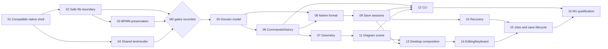

# ProcessCraft Implementation Plan

> **For agentic workers:** REQUIRED: Use superpowers:subagent-driven-development (if subagents available) or superpowers:executing-plans to implement this plan. Steps use checkbox (`- [ ]`) syntax for tracking. Read the applicable skill before execution; delegation and execution remain subject to the user's instructions and available tools.

**Goal:** Deliver a trustworthy first Windows analyst-editor slice, then extend it into the four-view offline ProcessCraft workbench.

**Architecture:** One toolkit-independent Rust engine owns project mutations, history, and queries. Desktop and CLI share that engine; I/O owns ZIP/JSON persistence and BPMN adapters, and a separate renderer supplies the canvas and exports. SQLite is permitted only for a demonstrated internal need and is absent from the initial dependency set.

**Tech Stack:** Rust; compatible egui/eframe; serde/serde_json; bounded ZIP with Stored/Deflate; quick-xml; tiny-skia; shared Rust text shaping/font outlines; UUIDs and SHA-256; clap; selected Craft helpers after compatibility checks.

---

**Date:** November 11, 2026. **Status:** M0 Tasks 01–04, M1 Tasks 05–16 and [M2 Tasks 17–23](m2-implementation-plan.md) implemented and reviewed within the documented Windows qualification boundaries. Medium save latency now meets its measured target; rename latency retains an explicit disposition. M3 has a temporary partial delivery under the [expanded M3 plan](m3-implementation-plan.md), stopped at the user's request; its full BPMN scope remains unfinished. M4 remains future work.

**Authority:** [architectural solution design](../design/solution-design.md), particularly sections 4–9 and 19–22; [editable FigCraft design](../../design/ProcessCraft.figcraft). The user accepted ZIP + JSON as the native format and SQLite only if needed internally. The previous architectural review applies to the specification, not to code or performance.

This plan details M0 and M1. M2–M4 have bounded outcomes and acceptance gates, not premature implementation scaffolds. No schedule or cross-platform qualification is claimed. Checked steps are recorded in the milestone evidence, including verification substitutions and limits.

## Execution rules and scope

- Work in `E:\Documenti\GitHub\ProcessCraft`. The M0 Cargo workspace exists; there is still no `.git` directory. Reuse this checkout; a worktree cannot be created before a repository exists. Do not initialize Git merely to satisfy a planning workflow.
- The user accepted the design and explicitly requested implementation through all of M1. Continue later milestones only when requested, without treating the approved architecture as a fresh approval requirement.
- Create each package/module only when its task adds real behavior. Finish with five packages: `processcraft-core`, `processcraft-io`, `processcraft-render`, `processcraft`, `processcraft-cli`.
- Each numbered task is one reviewable change. Its checkbox steps are execution checkpoints; parser, text, and storage work may require multiple short edits rather than a fictional five-minute estimate.
- For a behavior change: add the named regression, run it to observe the intended failure, implement the smallest fix, rerun the focused check. Add no test framework or generic event bus. Do not add tests for documentation or trivial styling alone.
- After the focused check passes, run `cargo fmt --all -- --check` and the affected package's Clippy check. Run the full workspace suite at milestone integration, or after changes with workspace-wide impact.
- If Git exists by execution time, inspect `git status --short`, preserve unrelated work, and commit the task's named files with the proposed message. Otherwise record the completed task and its check in the evidence log; do not claim a commit occurred.
- Do not add SQLite, a renderer abstraction, GPU compositor, plugin framework, spatial index, async core, or checkpoint object store without a measured reason. `// ponytail:` comments belong only on deliberate implementation shortcuts with a real ceiling and upgrade trigger.
- Keep all product labels, identifiers, diagnostics, documentation, and automation contracts in English. Process data remains Unicode.

### First usable workflow

Create a project and a procurement process: Start → Submit requisition → XOR decision → Approve request / Reject request → End, with labeled flows and lanes. Create and connect elements, edit labels/properties, move shapes, undo/redo, save, close, reopen, and reproduce the same domain state from a CLI batch. Switch Light/Dark without changing persisted process content. Recover unsaved edits after forced termination.

This proves the editor foundation. It does not claim a complete Signavio replacement, full BPMN coverage, or an implemented dictionary/table workflow.

### Dependency order



The arrows express prerequisites, not a request to delegate implementation. Execute sequentially until independent work actually helps.

### Files and responsibilities

Paths below are relative to the workspace root; no listed future file is implied to exist today.

| Path | Responsibility / introduced by |
|---|---|
| `Cargo.toml`, `Cargo.lock`, `rust-toolchain.toml`, `.gitignore` | Resolved workspace, pinned toolchain, generated/build-file exclusions; Task 01 |
| `docs/implementation/m0-evidence.md` | Machine/toolchain, resolved dependency/features/licenses, gate evidence, limitations; Tasks 01–04 |
| `docs/implementation/m1-evidence.md` | Acceptance results, artifact paths, observed timings, outstanding limitations; Task 16 |
| `crates/processcraft-core/src/{lib,ids,model,commands,history,identity,geometry}.rs` | Domain identities, persistent data, one mutation dispatcher, bounded history, content identity, coordinates/routes; Tasks 01, 05–07 |
| `crates/processcraft-core/tests/{domain,commands,geometry}.rs` | Domain/transaction/geometry regressions; Tasks 05–07 |
| `crates/processcraft-io/src/{lib,access,save,native,bpmn,recovery}.rs` | Grants, atomic staging, bounded project container, BPMN preservation, private recovery; Tasks 02–03, 08–10 |
| `crates/processcraft-io/tests/{storage,bpmn,native,recovery}.rs` | I/O and data-loss regressions |
| `crates/processcraft-render/src/{lib,scene,text,raster}.rs` | Immutable diagram primitives, shared glyph layout, CPU pixels; Tasks 04 and 11 |
| `crates/processcraft-render/tests/{text_parity,scene}.rs` | Shared glyphs, fallback, primitive and raster checks |
| `crates/processcraft-render/examples/text_parity.rs` | M0 evidence exporter for PNG/SVG/PDF, not an end-user export feature |
| `apps/processcraft/src/{main,app,theme,controller,jobs,canvas,outline}.rs` | Native composition, tokens, file/session lifecycle, bounded workers, gestures and keyboard alternative; Tasks 01, 13–15 |
| `apps/processcraft/src/controller.rs` (`#[cfg(test)] mod lifecycle`) | Controller/job lifecycle unit checks without a live GPU/window or an extra library target; Task 15 |
| `apps/processcraft-cli/src/{main,args,run}.rs` | Typed CLI commands, inspection, batch execution, explicit effects; Task 12 |
| `apps/processcraft-cli/tests/cli.rs` | Real subprocess outcomes, exit codes and file ownership; Task 12 |
| `tests/fixtures/{bpmn,native,commands,fonts}/` | Shared test data only; executable tests live in package test targets |
| `tests/fixtures/manifest.json` | Fixture origin, license/hash, expected mode and invariants; Task 03 onward |
| `assets/fonts/` | Only distributable, attributed fonts used by the application; Task 04 |

Create each package's `Cargo.toml` when introducing that package. `lib.rs` exports real modules and small public types; it does not accumulate the implementation. Split a module when a second substantial responsibility appears. Do not create the eventual `table`, `mcp`, `pdf`, `dictionary`, or `checkpoints` modules ahead of their tasks.

## Chunk 1: M0 and M1 — a safe, usable editor

### Task 01: Resolve dependencies and open a native window — G1

**Depends on:** accepted architecture. **Files:** root workspace files; `crates/processcraft-core/{Cargo.toml,src/lib.rs,src/ids.rs}`; `apps/processcraft/{Cargo.toml,src/main.rs,src/theme.rs}`; `docs/implementation/m0-evidence.md`.

- [x] Inspect installed Rust/Cargo and the pinned Craft manifests referenced in architecture section 24. Resolve one compatible egui family. Try one useful `craft-ui` control; if it brings conflicting framework types, use upstream widgets and record that outcome. Do not import the suite wholesale.
- [x] Create only core and desktop packages. Core supplies validated project/document IDs that the window actually uses. Desktop opens a native ProcessCraft window with an English project title, one labeled control, and Light/Dark selection. Install dependencies only for the behavior being built.
- [x] Pin the working toolchain and lockfile. Run `cargo check --workspace`, `cargo tree -d`, `cargo tree -e features`, and `cargo metadata --format-version 1 --no-deps`. Expected: successful resolution, one compatible egui type family, and no GUI dependencies in core. Inventory actual resolved features and licenses rather than relying on version strings.
- [x] Run `cargo run -p processcraft`. Verify native startup, focus, one interactive shared/upstream control, and theme switching on Windows. Record machine, display scaling, exact dependency pins, and G1 result in `m0-evidence.md`.
- [x] Check affected packages and record/commit `build: establish compatible Rust desktop baseline`. A blank shell is not M1 and must not show working save/model controls.

### Task 02: Prove atomic replacement, locks, and file grants — G2

**Depends on:** 01. **Files:** `crates/processcraft-io/{Cargo.toml,src/lib.rs,src/access.rs,src/save.rs,tests/storage.rs}`; M0 evidence.

- [x] Add `storage` integration cases named `failed_stage_keeps_original`, `second_writer_is_read_only`, `replacement_outcome_is_explicit`, and `denied_grant_writes_nothing`. Use real temporary directories; a child process holds the sidecar lock so the test proves interprocess exclusion.
- [x] Run `cargo test -p processcraft-io --test storage`. Expected before implementation: missing I/O behavior or failed assertions; investigate setup failures separately.
- [x] Implement exclusive sibling lock ownership using the standard library, explicit I/O grants, same-directory exclusive staging, and a single staging/replacement boundary. Evaluate pinned `craft-atomic`; keep it only if Windows behavior meets the contract. Return `NotCommitted`, `Committed`, or `Indeterminate`, never a success-shaped generic error.
- [x] Rerun the integration cases. Exercise NTFS sharing violations, access-denied and realistic staging failures; inject stage-boundary failures for deterministic coverage. Separately kill a child writer before/after replacement and verify the original or a complete replacement. Check ACL/metadata behavior and refuse unsupported cases rather than claiming transparent preservation.
- [x] Record G2 evidence, including which failures were injected versus physically reproduced, and record/commit `feat(io): establish safe file replacement and ownership`. This proves the file boundary; it does not yet freeze the project schema.

### Task 03: Prove namespace-aware BPMN source preservation — G3

**Depends on:** 01–02 (the I/O package exists after 02). **Files:** `crates/processcraft-io/src/bpmn.rs`, its manifest/lib exports, `crates/processcraft-io/tests/bpmn.rs`, `tests/fixtures/bpmn/{minimal,extensions,multiple-diagrams,unsupported-event}.bpmn`, fixture manifest, M0 evidence.

- [x] Add bounded fixtures with known IDs, namespace rebinding/QName attributes, vendor extensions, multiple diagrams, an unsupported event, malformed XML, and prohibited DTD/external-entity input. Record exact provenance/license/hash and expected mode. Synthetic cases avoid waiting for access to proprietary exports.
- [x] Add tests `preserved_source_is_byte_identical`, `qnames_keep_namespace_identity`, `unsupported_content_never_becomes_editable`, and `xml_limits_stop_before_commit`. Run `cargo test -p processcraft-io --test bpmn`; observe the intended missing behavior.
- [x] Implement bounded namespace-aware parsing and a capability report. At M0, unsupported documents may all use preserved-source/read-only mode with original bytes retained; do not build a partial editable importer that silently drops foreign attributes or elements. Reject DTD/external reads, excessive nesting, oversized text, invalid IDs/references and non-finite geometry as specified.
- [x] Rerun the tests. Reopen retained-source outputs in an independent local BPMN consumer, record tool/version and results, and distinguish source preservation from editable interchange. If the consumer is unavailable, mark G3 qualification pending; a self-round-trip is insufficient.
- [x] Record G3 result and record/commit `feat(io): preserve BPMN sources with explicit capabilities`. Narrow the editable profile if qualified retention cannot be demonstrated; do not bypass a failed preservation check.

### Task 04: Prove shared labels and CPU rendering — G4

**Depends on:** 01. **Files:** `crates/processcraft-render/{Cargo.toml,src/lib.rs,src/scene.rs,src/text.rs,src/raster.rs,tests/text_parity.rs,examples/text_parity.rs}`; `assets/fonts/`; font fixtures/manifest; M0 evidence.

- [x] Select distributable font bytes and retain licenses/hashes. Create samples for Latin accents, RTL, CJK, combining marks, wrapping, and a deliberately unavailable glyph. Exercise fallback with explicit coverage gaps; do not redistribute installed Segoe UI files.
- [x] Write `same_layout_drives_all_outputs` and `missing_glyph_reports_fallback`; run `cargo test -p processcraft-render --test text_parity` to observe the missing implementation.
- [x] Implement a small toolkit-free scene, shared shaping/fallback/outline layout, and tiny-skia rasterization. The M0 example sends those same glyph positions to PNG, outlined SVG and a candidate PDF path. PDF-specific dependencies stay in the evidence harness until the later product export feature needs them.
- [x] Run `cargo test -p processcraft-render --test text_parity` and `cargo run -p processcraft-render --example text_parity -- --out target/m0-text`. Expected: identical source layout/glyph positioning, declared fallback diagnostics, and generated PNG/SVG/PDF artifacts. Inspect outputs at 100%/200% scale and independently render the vector formats; don't require byte-identical files or identical antialiasing.
- [x] Record G4 and the aggregate G1–G4 decision. Fix failures or document an architectural revision before calling M0 complete. Record/commit `feat(render): qualify shared text and CPU primitives`.

**M0 exit:** G1–G4 have reproducible evidence or an explicitly revised, still safe boundary. An unavailable external consumer or unresolved Windows save behavior is a pending gate, not a pass. Implementation can continue on independent work while such a gate is pending, but M0/M1 qualification cannot silently skip it.

M1 Tasks 05–16 are implemented. See [M1 evidence](../implementation/m1-evidence.md) for final checks, the two accepted latency deviations and concrete coverage limits. Native pointer acceptance uses an actual egui widget with deterministic multi-frame input rather than unattended global mouse injection; save G/G+1 uses deterministic controller barriers. The Narrator smoke was completed and the tool stopped; the user explicitly prohibited further launches. No Git metadata exists in this checkout, so the planned commit steps were recorded as file changes without initializing a repository.

### Task 05: Implement the initial persistent process model

**Depends on:** M0 domain/preservation decisions. **Files:** core `src/{lib,ids,model,identity}.rs`, core `tests/domain.rs`, fixture manifest.

- [x] Define the actual M1 types: project metadata/folders/documents, BPMN definitions/process/collaboration, participants/lanes, initial editable elements/flows, separate DI shapes/edges, retained-source references and import capability. Use `(DocumentId, XmlId)` keys and absolute finite `f64` geometry. Keep the architecture's full initial editable profile explicit; the procurement demo alone is not its complete definition.
- [x] Add cases `ids_are_scoped_to_document`, `lane_membership_is_not_a_duplicate_node`, `multiple_diagrams_share_semantics`, `invalid_reference_is_rejected`, and `persistent_identity_covers_every_field`. Run `cargo test -p processcraft-core --test domain` before implementing their behavior.
- [x] Implement invariant checks for identity uniqueness, resolvable editable references, acyclic containment, lane membership, flow endpoint/process rules, finite bounds, and architecture limits. Model unsupported content through a retained-source capability, not through empty fake tasks. Keep dictionary, comments and checkpoints out of M1 behavior; when later added, extend schema and digest coverage together.
- [x] Implement deterministic persistent-content identity, excluding preferences, caches and preview/build metadata. Test changing metadata, folder structure, source resources and DI as well as labels. Use a schema-defined canonical encoding, stable map order and domain-separated hashes; don't hash raw unordered maps or physical ZIP bytes.
- [x] Rerun the domain cases and record/commit `feat(core): model BPMN identities and persistent state`. No GUI/XML/path types enter core.

### Task 06: Add one transactional command engine and bounded undo

**Depends on:** 05. **Files:** core `src/{commands,history,lib}.rs`, `tests/commands.rs`, `tests/fixtures/commands/procurement.json`.

- [x] Add typed commands/descriptors for the M1 mutations: create document/element/flow, rename/document properties, delete, move/reroute, lane membership, undo and redo. Commands expose stable external IDs; queries return immutable state. Separate request/session/generation metadata from persistent project data.
- [x] Add `failed_batch_preserves_state_and_history`, `generation_conflict_changes_nothing`, `one_batch_is_one_undo`, `undo_to_saved_content_is_clean`, and `history_budget_drops_only_undo`. Run `cargo test -p processcraft-core --test commands` before implementation.
- [x] Implement one session owner, copy-on-write preparation, invariant checks before commit, `ChangeSet` results and typed errors. Enforce the 1,000-mutation batch cap; reject history/effects inside batches. Explicit new IDs allow later commands in a batch to reference newly created objects. Use one undo entry per committed gesture/batch and the architecture's count/memory ceilings.
- [x] Rerun the focused tests. Include a batch whose final invalid connection fails after earlier valid changes, and verify byte-equivalent canonical content, selection context, generation, undo and redo state. Test every new persistent command invalidates content identity.
- [x] Record/commit `feat(core): transact commands with bounded undo`. A successful no-op must not create misleading dirty/history state.

The central regression is an observable transaction guarantee; adapt names to the final Rust API without weakening assertions:

```rust
let before = session.inspect();
let result = session.apply_batch(batch_with_invalid_final_connection());
assert!(result.is_err());
let after = session.inspect();
assert_eq!(after.content_id, before.content_id);
assert_eq!(after.generation, before.generation);
assert_eq!(after.history, before.history);
assert_eq!(after.selection, before.selection);
```

### Task 07: Add diagram geometry and bounded routing

**Depends on:** 05–06. **Files:** core `src/geometry.rs`, core `tests/geometry.rs`, relevant command variants.

- [x] Add `drag_commits_once`, `manual_route_survives_unrelated_edit`, `routing_is_deterministic`, `routing_budget_returns_warning`, and `bad_coordinates_are_rejected`. Run `cargo test -p processcraft-core --test geometry`.
- [x] Implement absolute diagram-plane bounds/waypoints, semantic hit regions and bounded deterministic orthogonal routing with stable tie-breaking. Start with linear bounds scans; retain a documented simple route plus warning when search cannot find a route within budget.
- [x] Define endpoint-move behavior: preserve the unaffected manual route interior where valid, move endpoints and repair adjacent orthogonal segments, and warn when an explicit reroute is needed. An unrelated rename/theme change must never reroute a connector. Multi-selection movement is one transaction.
- [x] Rerun focused tests on overlapping obstacles, zero-distance movement, extreme finite coordinates and invalid numbers. Record/commit `feat(core): add stable diagram geometry and routing`.

### Task 08: Implement the versioned ZIP/JSON native format

**Depends on:** 02 and 05–06. **Files:** I/O `src/native.rs`, manifests/lib exports, I/O `tests/native.rs`, `tests/fixtures/native/`, fixture manifest.

- [x] Define the first implemented schema and reader capabilities from actual M1 data, using architecture section 8's layout: `mimetype`, `manifest.json`, `project.json`, `resources/<sha256>`, optional `preview.png`. Later checkpoint payloads must use `checkpoints/<uuid>.json` when M3 adds the capability; do not emit invented empty checkpoint/comment content now. A future required capability must be refused safely.
- [x] Add `native_round_trip_preserves_content`, `unknown_required_capability_refuses_write`, `resource_digest_mismatch_fails`, `writer_cannot_exceed_reader_limits`, and `unsafe_archive_is_rejected`. Run `cargo test -p processcraft-io --test native`.
- [x] Implement streaming bounded reads/writes, version/schema checks, required-entry validation, immutable resources and canonical identity verification. Allow only Stored/Deflate; reject duplicate/unsafe names, symlinks/encryption, unsupported codecs and unknown content that cannot be preserved. Never extract arbitrary archive paths into the filesystem.
- [x] Cover missing/truncated entries, expanded-byte exhaustion, oversized JSON/preview/resource data and valid highly compressible JSON. Include one old-schema migration fixture: migrate in memory, preserve the source and require a backup or Save As before replacing an older representation.
- [x] Rerun the tests; open a written package with an independent ZIP reader and inspect its JSON. Record/commit `feat(io): persist versioned portable project packages`. Package save retains resources; a derived preview is never the model authority.

### Task 09: Connect project sessions to explicit save outcomes

**Depends on:** 02, 06 and 08. **Files:** I/O `src/{save,access,native}.rs`, `tests/storage.rs`; core saved-identity/session support.

- [x] Add `save_old_generation_keeps_new_edits_dirty`, `external_change_blocks_replace`, `save_as_failure_keeps_source_binding`, `indeterminate_save_requires_reconciliation`, `cancel_before_commit_keeps_original`, and `invalid_or_unflushed_stage_never_replaces_original`. Run `cargo test -p processcraft-io --test storage`.
- [x] Combine bounded package serialization with the existing lock/grant/staging boundary: finish the archive, reopen the staged file through the bounded native reader, verify manifest/required entries/content identity, flush the staged file, recheck target/grant under writer ownership, then replace atomically. Inject finalization/verification/flush failures and require `NotCommitted` with the original intact. On open/save retain the expected target identity/disk digest separately from canonical content identity; retain the documented limitation for non-cooperating external writers.
- [x] Return operation ID, originating session/target, saved content ID, observed disk identity and explicit outcome. Reconcile indeterminate outcomes by reopening and comparing; do not blindly retry a possibly committed write. Save As switches the session target/lock only after the new target's commitment is known; failure retains the old binding.
- [x] Rerun focused cases including Unicode/space-containing Windows paths, a changed target, read-only opening, exclusive destination staging, and close after an in-flight write. No failure truncates the original or marks unsaved content clean.
- [x] Record/commit `feat(io): reconcile native saves and external conflicts`. Export effects remain separate from domain batches.

### Task 10: Add bounded desktop recovery before relying on the editor

**Depends on:** 08–09. **Files:** I/O `src/recovery.rs`, I/O `tests/recovery.rs`, I/O exports; recovery scheduling is wired in Task 15.

- [x] Add `recovery_never_replaces_original`, `quota_preserves_last_valid_copy`, `interrupted_recovery_keeps_previous_copy`, and `recovered_content_starts_dirty`. Run `cargo test -p processcraft-io --test recovery`.
- [x] Implement private-directory complete package snapshots with origin/disk/generation metadata, using the same bounded format reader and safe writer. Apply two-second idle/30-second maximum scheduling inputs, a coalescing pending slot, at most two completed snapshots per project and 512 MiB total recovery quota including staging. Never delete the only recoverable work to free space.
- [x] Expose list/open/discard operations for explicit desktop choices. Recovered content opens in a separate dirty session and requires ordinary Save/Save As; it does not silently supersede the original. Keep timers out of core and hidden recovery out of headless runs.
- [x] Rerun tests, kill a recovery child writer, and verify at least the previous complete recovery remains usable. Record/commit `feat(io): retain bounded crash recovery snapshots`.

### Task 11: Build real diagram scenes from the domain

**Depends on:** 04–07. **Files:** render `src/{scene,text,raster}.rs`, render `tests/scene.rs`, `tests/fixtures/bpmn/` supported samples.

- [x] Add `scene_uses_semantic_element_keys`, `selection_is_excluded_from_document_scene`, `theme_keeps_document_identity`, and `explicit_imported_colors_are_preserved`. Run `cargo test -p processcraft-render --test scene`.
- [x] Map supported BPMN nodes, participants/lanes, flows, labels and hit regions to shared primitives and glyph runs. Produce CPU canvas pixels from immutable snapshots and font bytes. Model semantics remain in core; egui overlays remain outside render.
- [x] Distinguish native default diagram appearance from explicit imported colors. Default print appearance stays light; changing UI theme does not mutate geometry or the persistent project. Exercise empty, missing-font and multiple-diagram cases.
- [x] Rerun tests and inspect raster output of the procurement fixture in Light/Dark at two scales. Record/commit `feat(render): render BPMN scenes from project snapshots`. Full production SVG/PNG/PDF export controls remain later milestones.

### Task 12: Add the headless CLI over the same commands

**Depends on:** 03, 06, 08–09 and 11. **Files:** `apps/processcraft-cli/{Cargo.toml,src/main.rs,src/args.rs,src/run.rs,tests/cli.rs}`, command fixtures, README command examples.

- [x] Define info, command discovery, validate, and batch-run with explicit `--out`, plus explicit native create/open input. Parse paths as OS-native values. Command JSON uses the same descriptors/typed parameters and rejects unknown fields. No MCP transport or GUI attachment is added yet.
- [x] Add subprocess cases `cli_matches_engine_content`, `batch_failure_writes_nothing`, `gui_owned_file_refuses_headless_writer`, `paths_are_explicit_grants`, and `headless_run_creates_no_recovery_or_preferences`. Run `cargo test -p processcraft-cli --test cli`.
- [x] Implement command routing through core, bounded JSON requests, generation checks, session/grant lifecycle, structured diagnostics and safe save outcomes. Read-only inspection does not acquire a writing session. A direct writer refuses a project held by the GUI; no background listener starts.
- [x] Use architecture section 16.1's exit codes: `0` success, `1` runtime/I/O failure, `2` usage/schema failure, `3` validation errors found, `4` generation/file conflict, including writer-ownership conflict. Warnings alone do not fail validation. An indeterminate commit is exit `1` with a structured `Indeterminate` outcome/operation ID and required reconciliation, never an invitation to retry blindly. Keep machine results on stdout and progress/diagnostics on stderr. Add subprocess assertions for each exit category, warnings-only success, and the structured indeterminate outcome; do not depend on human prose.
- [x] Rerun subprocess tests, then execute the following workflow and record/commit `feat(cli): expose shared process commands headlessly`.

```powershell
cargo run -p processcraft-cli -- commands --json
cargo run -p processcraft-cli -- run --new --batch tests/fixtures/commands/procurement.json --out target/procurement.processcraft
cargo run -p processcraft-cli -- info target/procurement.processcraft --json
cargo run -p processcraft-cli -- validate target/procurement.processcraft --json
```

Expected: a complete native project with the intended branch/lanes, stable IDs, zero structural errors, and the same canonical identity as executing the same batch through core. Generated project IDs must be supplied by the reproducible fixture or excluded only from the comparison through an explicit test setup; never exclude project identity from production dirty-state hashing.

### Task 13: Compose the real desktop shell and inspector

**Depends on:** 01, 06, 09 and 11. **Files:** desktop `src/{main,app,theme,controller,canvas,outline}.rs`, desktop manifest; existing FigCraft assets are reference inputs only.

- [x] Replace the startup shell with a single-project workbench: document navigation, palette, canvas, properties, problems/save status, and native New/Open/Save/Save As. Read the 23 semantic variables from the approved FigCraft authoring data and map them to a small Light/Dark token struct. Do not build a token compiler.
- [x] Route all model actions to the session dispatcher. Selection, pan/zoom, panel sizes and theme stay outside persistent content. Inspector edits commit on explicit completion and surface validation failures without losing the entered value. Show `Source file` for import provenance and no fake `Approved` status.
- [x] Use native dialogs and the safe I/O controller. Save state reflects known committed identity, pending writes, conflicts and recovery failures. A read-only/retained-source document has explicit capability messaging and no enabled destructive editing controls.
- [x] Run `cargo run -p processcraft`; manually exercise New/Open/Save As, Unicode names, small-window panel collapse, focus, Light/Dark, and 100%/200% UI scaling. Verify pane resizing/theme changes leave content identity unchanged. Record/commit `feat(desktop): compose native workbench and inspector`.

### Task 14: Wire canvas gestures and a keyboard alternative

**Depends on:** 07, 11 and 13. **Files:** desktop `src/{canvas,outline,controller,app}.rs`; extend core geometry/command tests only for newly discovered regressions.

- [x] Implement select/create/connect/move/delete, multi-selection, pan/zoom and explicit reroute from typed intents. Screen transforms are view state; convert to diagram coordinates at the boundary. Pointer movement updates only a transient preview; release commits once and Escape cancels without a mutation.
- [x] Implement a logical outline with type/name/lane/connections and accessible control names. Keyboard users can select, inspect, rename, create/connect, move and delete through explicit actions, including choosing flow endpoints without dragging. This outline is the M1 alternative representation; the editable analyst table remains M2.
- [x] Run the existing command/geometry regressions and `cargo run -p processcraft`. Build the procurement fixture by mouse, then by keyboard. Check one undo per gesture, predictable focus, error text beyond color, cancellation, and selection synchronization between outline/canvas/inspector.
- [x] Perform a Windows Narrator smoke check for reachable element names/actions and focus. Record concrete limitations; AccessKit being enabled alone is not a pass. Record/commit `feat(desktop): edit processes by pointer and keyboard`.

### Task 15: Wire bounded jobs, asynchronous saves, and recovery lifecycle

**Depends on:** 09–10 and 13–14. **Files:** desktop `src/{jobs,controller,app}.rs`, with `#[cfg(test)] mod lifecycle` inside `controller.rs`.

- [x] Add `stale_render_is_discarded`, `old_save_acknowledgement_is_reconciled`, `closed_session_keeps_pending_write_record`, `newer_edits_stay_dirty`, and `recovery_queue_coalesces` in the controller's `lifecycle` unit-test module. Run `cargo test -p processcraft lifecycle`; expect all five named tests to execute. These checks access binary-crate internals without a library target, use deterministic worker barriers rather than sleeps, and do not open a window or GPU device.
- [x] Introduce bounded Rust channels/workers and job IDs. Render/validation jobs carry session/document/content/font/appearance generations; only matching derived results install. Do not queue a full render per pointer event. Immutable snapshots cross threads; the mutable session has one owner.
- [x] Route every committed/indeterminate file-effect acknowledgement to its originating session, target and operation, even after newer edits, tab/window changes or cancellation requests. Session completion records survive until writes settle. Never treat a committed save as discardable stale render data.
- [x] Wire recovery scheduling, startup selection, controlled shutdown and unsaved-work prompts. Keep at most one pending recovery snapshot; bound shutdown waiting and retain dirty work/error messaging when flushing fails. Changing projects must settle or retain outstanding effect records rather than reassign them.
- [x] Rerun lifecycle and I/O storage/recovery suites. In the GUI, save G, edit G+1 while the writer is held at a barrier, release it, and verify G+1 remains dirty; then force termination and recover. Record/commit `feat(desktop): reconcile bounded jobs and crash recovery`.

The lifecycle distinction must be visible in the check:

```rust
assert_eq!(session.saved_content_id(), saved_g.content_id);
assert_eq!(session.current_content_id(), edited_g1.content_id);
assert!(session.is_dirty());
assert_eq!(session.observed_disk_digest(), saved_g.disk_digest);
```

### Task 16: Qualify the first vertical slice — M1

**Depends on:** 01–15, with M0 qualification resolved. **Files:** `docs/implementation/m1-evidence.md`, `apps/processcraft-cli/examples/qualify.rs`, README, fixture manifest; modify product implementation only to fix demonstrated failures.

- [x] Run the milestone checks below. Expected: formatting, Clippy and workspace tests pass. Inspect Cargo metadata/transitive graphs to verify core has no GUI/I/O/network dependencies, I/O/render depend on core but not each other, CLI has no desktop dependency, and no SQLite or second rendering runtime was added.
- [x] Execute the procurement workflow in GUI and CLI, save/reopen and compare canonical content. Run failed-batch, external-change, ownership, interrupted-save, recovery, migration and source-preservation cases. Include selecting and editing a document with multiple diagrams. M1 import may remain preservation-only; do not advertise an editable BPMN importer unless G3 fixtures qualify it.
- [x] Exercise keyboard/Narrator, Light/Dark, 100%/200% scaling, constrained window width, Unicode labels and missing-font diagnostics. Retain screenshots and native fixture packages as evidence, without replacing approved design artifacts or recording private user processes.
- [x] Add a deterministic qualification example that generates the architecture's medium fixture: 20 documents/~5,000 total elements/~500 visible, around 20 MiB native data, plus small and near-limit variants. Run `cargo run --release -p processcraft-cli --example qualify -- --out target/m1-qualification`. Measure 30 warmed iterations after five warmups; report small-sample cold-open timings separately. Emit fixture counts/sizes and command/hit-test/raster/open/save timings as JSON. Record hardware, build mode and process memory with bounded history; note measurement limitations. Mark unmet targets and fix the measured bottleneck; no guessed pass or automatic database adoption.
- [x] Record each gate as pass/fail/pending with the exact command/manual procedure and artifact. Update README to distinguish implemented behaviors from prototypes and limitations. Record/commit `test: qualify first ProcessCraft editor slice`. M1 is complete only when no-loss, functional and keyboard gates pass and any performance deviations have an explicit disposition.

```powershell
cargo fmt --all -- --check
cargo clippy --workspace --all-targets -- -D warnings
cargo test --workspace
cargo tree -p processcraft-core
cargo tree -p processcraft-cli
cargo metadata --format-version 1 --no-deps
cargo run --release -p processcraft
```

## M2–M4 follow-on work

These are delivery slices for later detailed plans. Before executing each milestone, refine its tasks against the actual working APIs and the unchanged architectural invariants. Do not allocate speculative crates or duplicate the engine.

M2.1–M2.6 have now been executed through the [refined M2 plan](m2-implementation-plan.md). The [M2 evidence](../implementation/m2-evidence.md) records 217 passing tests, native/CLI/MCP integration, the qualified BPMN subset and actual limits. M3 is now being executed through the [expanded M3 implementation plan](m3-implementation-plan.md), including the user-approved complete BPMN modeling/interchange target. The remaining rows describe that required work and future M4.

| Order | Slice and implementation boundary | Acceptance evidence |
|---|---|---|
| **M2.1** | Library/folders, stable document queries, local filtering; core query modules and desktop panels | Same DocumentId from tree/list/CLI; rename/move is transactional; search scans measured before adding an index |
| **M2.2** | Dictionary entries, typed links, reverse usages, lane/role mapping | Rename updates every usage; deleting a used entry requires explicit mapping/unlink; ambiguous role-to-lane mapping asks for a lane; format and complete digest coverage evolve together |
| **M2.3** | Synchronized table projection and problems panel | Row IDs refer to real activities; rename/link delegates to existing commands; row order cannot flatten branches; unsupported content survives; stale diagnostics cannot target another element |
| **M2.4** | Qualified editable BPMN subset, preserved-source UX and export reports; expand M0 adapter | Capability matrix and per-fixture semantic/DI/foreign-content results; unsupported standard attributes are classified; source-preserved fixtures are not counted as editable |
| **M2.5** | User-facing SVG/PNG export from the existing shared scene | Exact-size bounds, same glyph layout, no selection overlays/scripts/external resources, failure never truncates output; omissions/fallbacks reported |
| **M2.6** | Opt-in stdio MCP and explicit same-user Windows named-pipe attachment | Descriptors/generation/file grants shared with GUI/CLI; unauthorized/remote clients refused; no listener by default; retries cannot silently replay a mutation; an agent edits the visible session safely |
| **M3.0** | [Deterministic, explicit auto-layout](m3-auto-layout.md) before all other M3 slices | Preview and atomic, stale-safe apply share one bounded offline engine; preserve semantics and unsupported data |
| **M3.1** | Local plain-text element comments | Stable IDs, explicit orphan behavior on deletion, undo/save/dirty coverage, descriptive author text with no authenticated identity claim |
| **M3.2** | Named checkpoints, local Reference marker, comparison/restore | Non-recursive immutable snapshots freeze dictionary context; restore is undoable and resolves identity conflicts explicitly; 20-checkpoint/expanded-size ceilings; no silent reference deletion |
| **M3.3** | Qualified PDF export using shared scene/glyph layout | Font licensing/embedding, Unicode extraction or explicit outline fallback, pagination; independent render/text checks |
| **M3.4** | Complete BPMN 2.0.2 modeling/interchange scope, including conversation and choreography | Per-construct and normative-constraint evidence for model/edit/render/import/export/validate; preserved XML alone is not implemented support |
| **M3.5** | Expanded MIWG/vendor interchange qualification and resource scaling | Provenance/license/hash per fixture; independent reopen in at least two qualified tool/version combinations before public compatibility claims; benchmark native saves/checkpoints near limits |
| **M4.1** | Windows packaging, file association, installer/uninstaller and release metadata | Clean Windows x64 install/open/edit/recover/export/uninstall; correct owned-file cleanup; original projects preserved; signing/update/rollback claims require their own evidence |
| **M4.2** | Accessibility and performance qualification of all four views | Keyboard-only modeling/table/dictionary workflows, Windows Narrator, focus/contrast/DPI, declared machine and recorded timing/memory targets; no invented cross-platform support |

Do not claim an agent-ready desktop alpha before explicit attachment and its authorization/grant checks exist. Do not label a local Reference as an authenticated approval. macOS/Linux qualification follows real platform tests, not merely portable compilation.

## Acceptance map and change triggers

| Requirement | First verification | Continued gate |
|---|---|---|
| Rust native/offline | 01, 12–13 | No required account/server; resolved runtime inventory |
| ZIP + JSON project ownership | 08–09 | One portable closed package, schema/capability migration policy |
| One mutation engine | 06, 12–14 | GUI/CLI/MCP/table parity without transport-specific edits |
| No-loss editing | 02, 06, 08–10, 15–16 | All architecture section 20.3 scenarios as features arrive |
| Unicode and shared rendering | 04, 11, 16 | SVG/PNG/PDF use qualified shared layout |
| English Light/Dark workbench | 01, 13–14, 16 | All four M2 views; themes do not mutate stored content |
| Dictionary/table/checkpoints | M2.2–M2.3, M3.2 | Frozen reference context and branch preservation |
| Agent readiness | 12, M2.6 | Opt-in same-user attachment and bounded granted effects |
| Keyboard/accessibility | 14–16 | M4 checks across every shipped workflow |

SQLite reconsideration requires measured library/search cost that memory scans/caches cannot meet. It may then hold a rebuildable index outside `.processcraft`; deleting that index must not lose models, dictionary data, comments, checkpoints or references. Using SQLite as the authoritative project store would be a separate architectural decision and is not authorized by this plan.

Other upgrade triggers remain architecture section 22: optimize save serialization/sharing before changing storage; profile hit-testing before adding a spatial index; profile rendering before adding another compositor. Narrow a BPMN editing capability if preservation fails instead of weakening the retention contract.

## Plan review record

The plan review preceded implementation. Execution of M0 is recorded in the [M0 evidence](../implementation/m0-evidence.md); the planning review itself does not certify runtime behavior or later gates.

An independent plan reviewer approved the revised document after two passes. The first pass found a CLI exit-code mismatch and missing explicit verification/flush of staged native packages before replacement; both were corrected, with failure checks specified. Dependency ordering and access to desktop lifecycle-test internals were also clarified. The second pass found no remaining concrete planning blockers. Local document checks confirmed 16 sequential tasks, checkbox steps, balanced code fences, a chunk below 1,000 lines, and valid relative file links.


