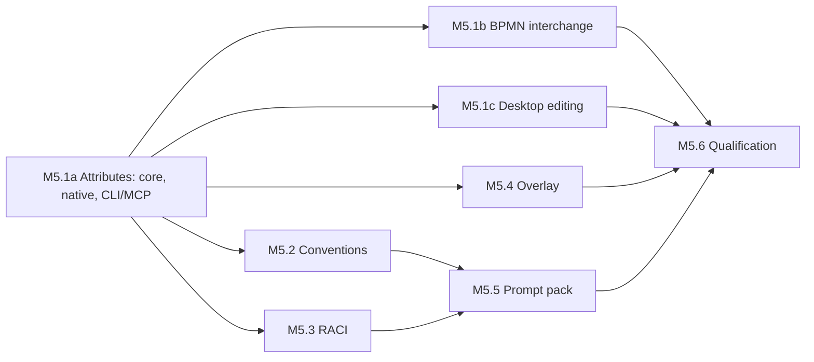

# ProcessCraft M5 Implementation Plan — Analyst foundations

**Goal:** Deliver M5.1–M5.5 of the [roadmap](roadmap.md): project-level custom attributes, a modeling
conventions profile, a RACI matrix, an attribute overlay on the diagram, and a documented MCP prompt
pack. M6–M9 build on these.

**Architecture:** No new crate and no new dependency. Attribute definitions, values and the conventions
profile are project content in `processcraft-core`, changed only through new `Mutation` variants, so
GUI, CLI and MCP share one schema. `processcraft-io` adds one native reader capability and one BPMN
extension namespace. `processcraft-render` gains an optional overlay input to the existing shared
scene. `io` and `render` still never depend on each other.

**Authority:** [roadmap](roadmap.md) §M5; [solution design](../design/solution-design.md) §5.3
(attributes use explicit units and decimal/string values), §6 (preservation contract), §7 (commands),
§8.2 (version contract), §10.1 (dictionary authority), §11 (table), §16 (CLI/MCP), §17.2 (limits).

**Status:** Planned; not started. Depends on M4 only for release packaging, not for code. The
recommended options of the former open decisions were adopted on 2026-11-13 (roadmap, "Decisions
taken") and are listed under [Decisions](#decisions-adopted-2026-11-13).

## Boundaries

In scope: what the roadmap lists under M5.1–M5.5, on Windows, for documents with
`Capability::Editable`. Read-only display of attribute values is allowed on
`Capability::RetainedExtensions`; nothing is offered on `Capability::PreservedSource`.

Out of scope, and not to be scaffolded:

- Attribute types beyond the roadmap list; computed or formula attributes; per-attribute permissions.
- Attributes on dictionary entries or on documents (solution design §10.1 mentions typed dictionary
  attributes; they wait for a concrete need — M7 resource cost is the first candidate).
- A generic rule engine or user-scripted convention rules. Rules are a closed Rust enum.
- Natural-language analysis beyond a word-list heuristic for the verb + object rule.
- An MCP `prompts` capability in the server. M5.5 ships documents and a replayed transcript only.
- A model client or any network access.

## Findings from the current code that shape this plan

These were verified by reading the code on 2026-11-13; each one changes a task below.

1. **The native format has evolved through required capabilities, not schema bumps, since schema 3.**
   `crates/processcraft-io/src/native.rs` keeps `Manifest.schema == 3` and adds a capability string
   (`DEFINITIONS_CAPABILITY`, `COMMON_METADATA_CAPABILITY`, …) only when a project uses the feature.
   New `ProjectData` fields are `#[serde(default, skip_serializing_if = …)]`, so the content identity
   (`ProjectData::content_identity`, `crates/processcraft-core/src/identity.rs`) of existing files does
   not change and `LoadedProject.requires_save_as_or_backup` stays `false` (`manifest.schema < 3`).
   M5 follows the same route (Decision 1).
2. **`Node.owner` and `Node.contact` already exist** (`model.rs`), with `Mutation::SetNodeOwnerContact`,
   an inspector section ("Responsibility & systems", `apps/processcraft/src/app/inspector.rs`) and a
   BPMN export rule that treats them as native-only fields requiring `acknowledge_native_fields`
   (`interchange.rs`, "Node owner and contact are native-only fields"). An "Owner" starter template
   would overlap them (Decision 2).
3. **IT systems are already dictionary links** (`DictionaryKind::System`, `DictionaryLink`,
   `ActivityRow.systems`). An "IT system" starter attribute would store the same fact twice
   (Decision 2).
4. **Only the GUI shows diagnostics today.** `ProjectData::diagnostics()` (`validation.rs`) is called
   from `DiagnosticsWorker` (`apps/processcraft/src/jobs.rs`). CLI `validate` (`run.rs` `inspect`) and
   the MCP `validate` tool (`mcp.rs`) run only the structural `ProjectData::validate()` and return
   `valid: true`. "Identical across GUI, CLI and MCP" therefore first needs CLI and MCP to expose
   diagnostics at all (Task M5.2).
5. **Built-in diagnostics overlap three convention rules:** `missingStart`, `missingEnd`,
   `unnamedExclusiveGateway`, `unconnectedNode`, `gatewayDoesNotSplitOrMerge` already exist.
6. **`tDefinitions` has no `extensionElements`** in the pinned XSD, so attribute definitions cannot be
   written once at file level in a schema-valid way. Values are therefore self-describing (Task M5.1,
   step 7).
7. **The MCP query enum exists twice:** `enum Query` in `apps/processcraft-cli/src/mcp.rs` and in
   `apps/processcraft/src/attachment.rs`. Every new query kind is added to both.
8. **Clipboard and `duplicate` do not copy dictionary links** (`clipboard.rs` has no project-level link
   handling). Attribute values follow the same behaviour in M5 (Decision 6).
9. **`ActivityRow.role` is a display label, not an identity** (`queries.rs`, `activity_table`): it
   is the name of the lane's `Role` link, resolved to a string. Two roles with the same name, or a
   renamed entry, cannot be told apart from it, so RACI (M5.3) reads the lane's link target itself.

## Delivery order



M5.1 is delivered in three phases, each one a mergeable commit set that passes the quality gates on
its own. M5.1a has one writer for `model.rs`, `commands.rs`, `identity.rs` and `native.rs`. After it
lands, M5.1b (`interchange.rs`), M5.1c (inspector, table, Dictionary view), M5.2 (core validation +
CLI), M5.3 (query + view) and M5.4 (render + canvas) touch mostly disjoint files and can run in
parallel; `commands.rs`, `native.rs` and `attachment.rs` still have one writer at a time.

## Task M5.1: Custom attributes

Three phases. Each ends with the quality gates passing and its own tests green; later phases add
surfaces, never change the model or the native format defined in M5.1a.

### Phase M5.1a: model, commands, native format, CLI and MCP

**Own:** new `crates/processcraft-core/src/attributes.rs`; `crates/processcraft-core/src/{ids,model,
commands,identity,history,queries,element_identity_edit,lib}.rs`; `crates/processcraft-io/src/
native.rs`; `apps/processcraft-cli/src/{args,run,mcp}.rs`; `apps/processcraft/src/attachment.rs`.

After this phase attributes are fully usable headless: an agent or a CLI batch can define them, set
values, query them and save them. The GUI shows nothing new yet.

#### Model

- [x] Add `AttributeDefinitionId` (UUID newtype) to `ids.rs`, following `DictionaryEntryId`.
- [x] In `attributes.rs` define, all `deny_unknown_fields` with `schemars::JsonSchema`:
  - `AttributeType`: `Text`, `Number`, `Duration`, `Currency`, `Enum`, `Date`, `DictionaryRef`, `Url`.
  - `AttributeTarget`: `Activity`, `Event`, `Gateway`, `SequenceFlow`, `Lane`, `Participant`,
    `Process`, `DataObject`. One function maps an element of a `BpmnDocument` to its target
    (`NodeKind::is_activity`, event and gateway kinds, `FlowKind::Sequence`, …); every other caller
    uses it.
  - `AttributeDefinition { id, name, description, value_type, unit: Option<String>, options:
    Vec<String>, dictionary_kind: Option<DictionaryKind>, applies_to: Vec<AttributeTarget>,
    required: bool }`. `unit` is a free label for `Number` and an ISO 4217 code for `Currency`;
    `options` is used only by `Enum`; `dictionary_kind` only by `DictionaryRef`.
  - `AttributeValue`: `Text(String)`, `Number(String)`, `Duration(String)`, `Currency(String)`,
    `Enum(String)`, `Date(String)`, `DictionaryRefs(Vec<DictionaryTarget>)`, `Url(String)`.
    Numbers and currency amounts are canonical decimal strings, never `f64` (solution design §5.3).
    `Duration` is the ISO 8601 subset `PnDTnHnMnS` (no years or months); `P1D` is exactly 24 hours
    of elapsed time, never a working day. Working-time semantics belong to the M7 scenario
    calendars, and the editor and the evidence file say so. `Date` is `YYYY-MM-DD`.
    `DictionaryRefs` reuses the existing `DictionaryTarget::{Entry, Literal}` so an imported label can
    stay an unlinked literal (§10.1); it is a list because RACI (M5.3) assigns several roles.
  - `AttributeAssignment { source: ElementKey, definition: AttributeDefinitionId, value }`.
- [x] Add `attribute_definitions: Vec<AttributeDefinition>` and `attribute_values:
  Vec<AttributeAssignment>` to `ProjectData` and `FrozenProject` with `#[serde(default,
  skip_serializing_if = "Vec::is_empty")]`; extend `ProjectData::new`, `FrozenProject::capture` and
  `FrozenProject::project`. Values live at project level keyed by `ElementKey`, like
  `dictionary_links`; `Node`, `Flow` and `Lane` are not changed (their struct literals appear in
  dozens of files).
- [x] One pure `attributes::parse_decimal` / `parse_duration` / `parse_date` set of validators with
  canonical output, used by mutations, validation and import. Limits as constants: 200 definitions per
  project, 64 enum options, 16 dictionary references per value, text and URL values within the
  existing 16 KiB `short()` limit, at most one value per (source, definition). URLs are stored as
  text; the application never fetches them.
- [x] Extend `ProjectData::validate()` (`identity.rs`), next to the dictionary link checks: unique
  definition IDs and names, type-specific definition fields, every value's definition exists and its
  variant matches the definition type, enum value is one of the options, dictionary entries exist with
  the right kind, the source document and element exist (`semantic_ids`), no duplicate (source,
  definition). `applies_to` is **not** a structural invariant: it is enforced when a value is set and
  reported as a diagnostic otherwise, so `replaceElement` can never make a project unloadable.
- [x] Add the two vectors to `same_checkpoint` in `identity.rs` and to the retained-memory estimates
  in `history.rs` (the blocks that count `dictionary_entries` and `dictionary_links`).

#### Commands

- [x] Add to `Mutation` in `commands.rs`, with their application in `mutate` and entries in
  `COMMAND_DESCRIPTORS`:
  - `CreateAttributeDefinition { definition }`.
  - `UpdateAttributeDefinition { definition, resolution: AttributeUpdateResolution }`. Renaming,
    description, `required`, `unit`, adding options and widening `applies_to` always succeed: values
    refer to the definition by ID, as dictionary usages do. `value_type` is immutable. Removing or
    renaming an enum option, or narrowing `applies_to`, while affected values exist is rejected unless
    the resolution says what to do: `Reject` (required on the wire, like `DictionaryDeleteResolution`),
    `Clear` (drop affected values) or
    `MapOptions(Vec<{from, to}>)`.
  - `DeleteAttributeDefinition { definition_id, resolution: AttributeDeleteResolution }` with
    `Reject`, `Discard` or `MoveTo(AttributeDefinitionId)` (same type required), mirroring
    `DictionaryDeleteResolution`.
  - `SetAttributeValues { source: ElementKey, values: Vec<{ definition_id, value:
    Option<AttributeValue> }> }`; `None` clears. Uses the same `doc(p, source.document_id, true)`
    capability check as `SetDictionaryLinks`, and rejects a definition whose `applies_to` excludes the
    element. Editing many elements is several of these in one `Request::Batch` (existing 1,000 limit),
    which is one undo step.
- [x] Extend `Mutation::DeleteDictionaryEntry`: `Reject` also counts usages in attribute values;
  `Replace` retargets them; `Unlink` turns them into `DictionaryTarget::Literal` with the entry name.
  Extend `queries::dictionary_usages` to include elements that reference the entry through an
  attribute.
- [x] Keep values consistent with element lifetime. `commands.rs` prunes `links` and
  `dictionary_links` in six places (`prune_removed_activity_navigation`,
  `delete_choreography_flow_element`, the choreography artifact and data-association deletes,
  `Mutation::Delete`, `Mutation::DeleteDocument`). First fold those into one helper that prunes all
  project-level element references, then add `attribute_values` to it; do not add a seventh copy.
  Add `attribute_values` sources to the selector remap at the end of
  `element_identity_edit::set_xml_id`.
- [x] Add `attributes::starter_definitions()` returning the starter set with fresh IDs (see Open
  decision 2 for the exact list). It is data for the GUI button and the prompt pack; nothing creates
  definitions implicitly.

#### Queries

- [x] `queries::attribute_definitions(project)` with a usage count per definition, and
  `queries::element_attributes(project, document_id)` returning, per element, its target, name and
  values. Add `attributes: Vec<AttributeAssignment>`-style cells to `ActivityRow` (additive JSON).
- [x] Add the per-element values to `compare_checkpoint`: an `attributes_changed: bool` on
  `CheckpointComparison` and a `PropertyDifference` per changed value on the element's
  `ElementChange.properties`, with `property` = `attribute:<definition name>`.

#### Native format

- [x] In `native.rs` add the two fields to `ProjectDto` and `FrozenDto`, a constant
  `ANALYST_ATTRIBUTES_CAPABILITY = "analyst-attributes-v1"` pushed by `write_bytes` when the project
  or any checkpoint has a definition or a value, the same string in the reader allow-list in
  `load_with_limits`, and the "requires capability" refusal when the data is present without it.
  `Manifest.schema` stays 3.
- [x] Prove that existing files are untouched: `tests/fixtures/native/identity-baseline-2f0f770
  .processcraft` loads with the same content identity and re-saves without the new capability.

#### CLI and MCP

- [x] CLI `query attributes <document_id>` and definition listing in `Query` (`args.rs`,
  `query_project` in `run.rs`); MCP `Query::Attributes { document_id, offset, limit }` in `mcp.rs`
  **and** `attachment.rs`. Mutations need no transport work: `commands --json` and the MCP `apply`
  schema are generated from `Mutation`.
- [x] Add `tests/fixtures/commands/attributes.json`: a batch that creates definitions and sets values
  on the procurement process, with a manifest entry.

#### Tests

- New `crates/processcraft-core/tests/attributes.rs`: every type's validator (accept, reject,
  canonical form); set/clear; `applies_to` refusal; each update and delete resolution; failed batch
  leaves state, history and generation unchanged; undo/redo; values pruned on element and document
  delete and remapped on `setElementXmlId`; dictionary entry delete with each resolution; checkpoint
  capture/restore/compare; limits.
- `crates/processcraft-core/tests/commands.rs`: `descriptors_match_protocol_tags` and
  `analyst_workbench.rs` `request_schema_covers_all_discovered_tags` cover the new variants.
- `crates/processcraft-io/tests/native.rs`: round trip with attributes; capability present only when
  used; payload without capability refused; baseline identity unchanged.
- `apps/processcraft-cli/tests/cli.rs`: `run` with `attributes.json`, `query attributes`, `query
  table` shows the values; MCP stdio `apply` + `query` returns the same values.

**Exit:** a project with all eight types saves, reopens with the same content identity and answers
the same values through CLI `query` and MCP `query`; deleting a used definition fails without a
resolution.

### Phase M5.1b: BPMN interchange

**Own:** `crates/processcraft-io/src/interchange.rs`; the import commit in `apps/processcraft/src/
app.rs` (`ResultValue::Import`) and `import_bpmn_cli` in `apps/processcraft-cli/src/run.rs`; new
fixtures under `tests/fixtures/bpmn/attributes/`.

- [x] Namespace constant `PC_ATTRIBUTES_NS = "urn:processcraft:attributes:1"` in `interchange.rs`
  (Decision 3). Shape, written as the last child of the owner's `extensionElements`:

  ```xml
  <pc:attributes xmlns:pc="urn:processcraft:attributes:1">
    <pc:attribute definition="UUID" name="Cost" type="currency" unit="EUR">12.50</pc:attribute>
    <pc:attribute definition="UUID" name="Consulted" type="dictionaryRef" dictionaryKind="role">
      <pc:ref entry="UUID" name="Finance lead"/>
      <pc:ref name="External auditor"/>
    </pc:attribute>
  </pc:attributes>
  ```

  Each value carries its definition ID, name, type and unit, so a file is readable without a
  definitions block (finding 6).
- [x] Export: in `export_document`, on the cloned document the writer already prepares, append the
  `pc:attributes` element to each owner's `BaseExtras.extension_elements` /
  `BaseMetadata.extension_elements` (creating it when absent) through
  `metadata_visit::visit_legacy_metadata_mut` and `visit_base_metadata_mut`; the existing
  `write_extension_elements` then emits it after any foreign content. `export_bpmn` passes the
  project's definitions and the document's values in. Report "Custom attribute values written to the
  ProcessCraft extension namespace" in `ExportReport.transformed`. Definitions without values and
  definition metadata that values do not carry (`required`, `applies_to`, unused options,
  description) go to `ExportReport.omitted` under the existing `acknowledge_native_fields` rule. An
  owner kind for which no qualified metadata writer exists blocks the export instead of dropping the
  value (existing rule at "documentation or extension metadata on an owner without a qualified
  writer").
- [x] Import: `prepare_import` lifts well-formed `pc:attributes` elements out of the parsed
  `extension_elements` into a new `PreparedImport.attributes { definitions, values }` and removes them
  from the XML content so they are not stored twice. A `pc:attributes` element that fails validation
  (unknown type, malformed decimal, unexpected child) is left in place as ordinary extension content
  and named in `ImportReport.limitations`: preserved, not reinterpreted. Foreign extension nodes keep
  their order and bytes as today.
- [x] Commit: the GUI import handler (`app.rs`, `ResultValue::Import`) adds
  `CreateAttributeDefinition` for definitions the project lacks and `SetAttributeValues` to the same
  batch as `CreateDocument`. A definition ID that exists with a different type gets a fresh ID and a
  " (imported)" name suffix, reported in the status message. A `pc:ref` whose entry ID is not in the
  project becomes a `Literal` (§10.1: no identity merging by spelling). `import_bpmn_cli` fills the
  new `ProjectData` the same way before `Session::new`.
- [x] Add fixture `tests/fixtures/bpmn/attributes/foreign-and-processcraft.bpmn` (synthetic, CC0):
  Camunda-style foreign extension elements and `pc:attributes` on the same task; plus a malformed
  variant. Sibling `*.manifest.md` with provenance, licence, SHA-256 and expected import mode.

#### Tests

- New `crates/processcraft-io/tests/attributes_interchange.rs`: native → BPMN → native keeps every
  value and type; foreign extensions on the same element survive in order; malformed `pc:attributes`
  preserved as extension content with a limitation; re-import into the same project binds dictionary
  entries by ID and into an empty project yields literals; exported XML validates against the pinned
  XSD through `scripts/check_bpmn20_xsd.py`.
- `apps/processcraft-cli/tests/cli.rs`: `import-bpmn` of the fixture followed by `query attributes`.

**Exit:** acceptance items (a) and (b) below.

### Phase M5.1c: desktop editing

**Own:** `apps/processcraft/src/app/{inspector,analyst_views}.rs`, new
`apps/processcraft/src/app/attributes.rs`, and the editable-cell callback in the shared table widget.

- [x] New `apps/processcraft/src/app/attributes.rs`: an "Attributes" tab in the Dictionary view
  (`analyst_views.rs`, beside the entry list) to create, edit and delete definitions. Delete and the
  restricted updates open the same kind of explicit resolution prompt the dictionary delete uses. An
  "Add starter attributes" action submits `CreateAttributeDefinition` for the starter definitions
  missing by name.
- [x] Inspector (`inspector.rs`): an "Attributes" `widgets::section` listing the definitions that
  apply to the selected element, with a typed editor per type (text field, validated decimal, duration
  field, option list, date field, dictionary entry picker reusing `dictionary_links_ui` patterns, URL
  text). Edits go through the existing draft/auto-commit path and submit one `SetAttributeValues`.
  Invalid input keeps the draft and shows the validator message; it never submits.
- [x] Table (`activity_table_ui`): a column chooser for attribute definitions that apply to
  activities; chosen columns are view state, not project content. Cells edit in place and submit
  `SetAttributeValues`; a multi-row selection applies one value to all selected rows as one batch.
  `data_table` currently renders fixed text cells, so it gains an editable-cell callback rather than
  a second table implementation.
- [x] Every new control has an accessible name and is reachable by keyboard, as the existing
  dictionary and table controls are.

#### Tests

GUI unit tests in `apps/processcraft/src/app/attributes.rs` and `analyst_views.rs`: invalid draft
does not submit; multi-row edit is one undo step; drafts survive view changes; the restricted update
and the delete open the resolution prompt instead of submitting.

**Exit:** acceptance item (c) reachable from the GUI as well as from a batch.

### Acceptance

Roadmap acceptance, made exact: (a) the round trip test passes for all eight types; (b) the
foreign-extension fixture re-exports with its foreign nodes unchanged; (c) deleting a definition, or
removing an option or narrowing the element kinds, with values in use fails with `InvalidParams`
unless a resolution is given. Renaming a definition needs no resolution because values refer to it by
ID, as dictionary usages do. `value_type` cannot change: a definition of the wrong type is
replaced by creating a new one and re-entering the values.

## Task M5.2: Modeling conventions

**Own:** new `crates/processcraft-core/src/conventions.rs`; `validation.rs` (one call site),
`model.rs`, `commands.rs`, `native.rs`; `apps/processcraft-cli/src/{args,run,mcp}.rs`;
`apps/processcraft/src/attachment.rs`; `apps/processcraft/src/app/shell.rs` and a new
`apps/processcraft/src/app/conventions.rs`.

- [x] Model: `ConventionsProfile { rules: Vec<ConventionRule> }` with at most one entry per rule;
  `ConventionRule` is a serde-tagged enum whose variants carry `severity: DiagnosticSeverity` and
  their parameters:
  - `LabelRequired { kinds: Vec<AttributeTarget> }`
  - `ActivityVerbObject { verbs: Vec<String> }` — empty means the built-in English list
  - `GatewayFlowsLabelled`
  - `NoImplicitSplitJoin`
  - `SingleStartEnd`
  - `MaxElements { limit: u32 }`
  - `RequiredAttributes` — uses `AttributeDefinition.required` and `applies_to`
  - `DictionaryTerms`

  `DiagnosticSeverity` gains `Deserialize` and `JsonSchema`. A rule that is absent is off.
  `ProjectData.conventions: Option<ConventionsProfile>` (serde default, skipped when `None`), also in
  `FrozenProject`. `ConventionsProfile::recommended()` returns all eight rules as warnings with
  `MaxElements { limit: 50 }`.
- [x] Command: `Mutation::SetConventionsProfile { profile: Option<ConventionsProfile> }`, a
  whole-value setter like `SetSupportingCatalog`, plus its descriptor. Validation bounds: 2,000 verbs,
  each within 64 bytes; `limit` within 1..=10,000.
- [x] Native: capability `"modeling-conventions-v1"` written only when a profile is stored; reader
  allow-list and refusal as in M5.1.
- [x] Evaluation: `conventions::diagnostics(project, profile) -> Vec<Diagnostic>` walking
  `queries::scopes(document)` once per document, for `Capability::Editable` documents only. Codes are
  `&'static str` like the existing ones: `conventionLabelRequired`, `conventionActivityVerbObject`,
  `conventionGatewayFlowLabel`, `conventionImplicitSplit`, `conventionImplicitJoin`,
  `conventionStartCount`, `conventionEndCount`, `conventionMaxElements`,
  `conventionRequiredAttribute`, `conventionDictionaryTerm`. Rule definitions:
  - *Verb + object*: the label has at least two words and its first word, compared
    case-insensitively, is in the verb list. This is a word-list heuristic and the message says so.
    The built-in list is a `const &[&str]` in `conventions.rs`.
  - *Gateway flows labelled*: every non-default outgoing sequence flow of an exclusive or inclusive
    gateway with two or more outgoing flows has a non-empty name.
  - *Implicit split/join*: an activity or event with more than one outgoing, or more than one
    incoming, sequence flow.
  - *Single start and end*: exactly one start event and one end event per scope (process or
    sub-process level).
  - *Maximum elements*: shapes per `Diagram`, reported on the diagram's plane element.
  - *Dictionary terms*: a lane without a `DictionaryKind::Role` entry link, and any
    `DictionaryTarget::Literal` in dictionary links or attribute values.
  Output is capped at 10,000 diagnostics with a final "more results omitted" entry.
- [x] One result for all surfaces: `ProjectData::diagnostics()` appends
  `conventions::diagnostics(self, profile)` when `self.conventions` is `Some`. A second entry point
  `ProjectData::diagnostics_with(&ConventionsProfile)` serves the CLI override. Where a convention
  rule covers the same condition as a built-in diagnostic, the built-in one is not emitted for that
  element while the rule is on: `SingleStartEnd` supersedes `missingStart`/`missingEnd`,
  `LabelRequired` supersedes `unnamedExclusiveGateway`. The other built-ins stay: `unconnectedNode`
  and `gatewayDoesNotSplitOrMerge` (a gateway with one incoming and one outgoing flow) describe
  conditions no rule covers, and `NoImplicitSplitJoin` looks only at activities and events. The
  supersede table is one `const` and has a test that no element receives two diagnostics for one
  condition, run on fixtures that trigger every built-in code next to every rule.
- [x] CLI: `validate <PATH> --json` adds `diagnostics`, `errorCount` and `warningCount` to its output.
  `--profile <FILE>` evaluates a profile JSON file (same schema as the mutation payload, bounded by
  the 4 MiB request limit and strict JSON parsing) instead of the stored one; without the flag the
  stored profile applies. Exit 3 when any diagnostic has severity `error`, else 0 — warnings alone do
  not fail (solution design §16.1). `--fail-on warning` opts into failing on warnings.
- [x] MCP: add `Query::Diagnostics { offset, limit }` to `mcp.rs` and `attachment.rs` (paginated like
  the other kinds). The `validate` tool keeps empty arguments and adds `errorCount` and
  `warningCount` to its result.
- [x] Desktop: a "Conventions…" action in the Problems tab header (`shell.rs` bottom panel) opens a
  window (`conventions.rs`) listing the eight rules with Off/Warning/Error, the element limit and the
  verb list; Apply submits `SetConventionsProfile`. `problems_ui` needs no change: results arrive
  through `DiagnosticsWorker` and navigate by `document_id`/`element_id` as today.
- [x] Fixtures: `tests/fixtures/conventions/` with one batch that satisfies every rule (`pass.json`)
  and one failing batch per rule (`fail-<rule>.json`), each in the manifest. The shared passing batch
  is the passing fixture of every rule (Decision 5).

**Tests:** new `crates/processcraft-core/tests/conventions.rs` (per rule: the passing fixture yields
no `convention*` code, the failing fixture yields exactly the expected code, element and severity;
severity and parameters are honoured; supersede table; cap; nested sub-process scopes; non-editable
documents skipped). `crates/processcraft-io/tests/native.rs` (profile round trip and capability).
`apps/processcraft-cli/tests/cli.rs`: `validate --json` exit 0/3, `--profile`, `--fail-on`; a test
that applies each failing fixture and asserts the `diagnostics` array from CLI `validate`, from CLI
`query diagnostics` and from the MCP stdio `query` are byte-identical JSON. A unit test in
`apps/processcraft/src/jobs.rs` asserts `DiagnosticsWorker` returns `project.diagnostics()` for the
same snapshot.

**Acceptance:** every rule has its passing and failing fixture; the three-surface equality test
passes; `validate` exit codes follow §16.1.

## Task M5.3: RACI matrix

**Own:** `crates/processcraft-core/src/{attributes,queries}.rs`; `apps/processcraft/src/app/
analyst_views.rs`; `apps/processcraft-cli/src/{args,run,mcp}.rs`; `apps/processcraft/src/
attachment.rs`.

- [x] Three well-known definitions with fixed IDs in `attributes.rs`: Accountable, Consulted,
  Informed; type `DictionaryRef` with `dictionary_kind: Role`, `applies_to: [Activity]`. They are
  created by a normal `CreateAttributeDefinition` the first time the RACI view assigns a value, never
  implicitly on load. Fixed IDs let BPMN round trips and other projects recognise them.
- [x] `queries::raci_matrix(project, document_id, process_id) -> Option<RaciMatrix>`: columns are the
  roles in use (dictionary entries first, then literals), rows are the activities of
  `activity_table`, each cell a set of R/A/C/I. Responsible is derived, read-only: the `Role` link
  target of the activity's lane, read from `dictionary_links` as a `DictionaryTarget`, not the
  `ActivityRow.role` label (finding 9). A/C/I come from the three attributes. Columns are keyed by
  `DictionaryTarget` (entry ID, or literal text), so R and A/C/I for the same entry share one
  column even after a rename, and two entries with the same name stay two columns.
- [x] `queries::raci_csv(&RaciMatrix) -> String`: RFC 4180 quoting, CRLF, UTF-8 with BOM, first
  column activity name, one column per role, cells such as `R` or `A,C`. Cells that begin with `=`,
  `+`, `-` or `@` are prefixed with `'` so imported names cannot become spreadsheet formulas.
- [x] CLI: `query raci <document_id> <process_id>` (JSON) and `export-raci … --out <file.csv>
  [--overwrite]` using the existing `write_export` path. MCP: `Query::Raci` in both enums; no CSV
  file tool (an agent can format the JSON).
- [x] Desktop: a third segment "RACI" beside "Model" and "Table" in `activity_table_ui`. A grid with
  a sticky first column; A/C/I cells toggle by click or keyboard and submit `SetAttributeValues`; the
  R cell explains that it follows the lane's role. "Export CSV" writes through
  `Effects::write` with an explicit save dialog grant.
- [x] The handbook export listed in the roadmap consumes `raci_matrix` in M6.1; nothing to do here.

**Tests:** `crates/processcraft-core/tests/attributes.rs` additions or a new `raci.rs`: derivation
from lanes, literals versus entries, role rename reflected, activities outside lanes, CSV quoting and
formula-prefix cases, deterministic column and row order. `apps/processcraft-cli/tests/cli.rs`:
`export-raci` writes the expected bytes and refuses to overwrite without the flag. GUI unit test:
toggling a cell is one undo step.

**Acceptance:** the procurement fixture with two lanes and A/C/I assignments exports a CSV whose
content equals a pinned expected file; the matrix shown in the GUI, `query raci` and the CSV agree.

## Task M5.4: Attribute overlay

**Own:** new `crates/processcraft-core/src/overlay.rs`; `crates/processcraft-render/src/{bpmn,
export,lib}.rs`; `apps/processcraft/src/{jobs.rs,app/canvas.rs,app/overlays.rs,effects.rs}`;
`apps/processcraft-cli/src/{args,run,mcp}.rs`; `apps/processcraft/src/attachment.rs`.

- [ ] Core, pure data and one projection:
  - `Overlay { entries: Vec<OverlayEntry>, legend: Vec<LegendItem>, title: String }`,
    `OverlayEntry { element: ElementSelector, bucket: Option<u8>, badge: Option<String> }`,
    `LegendItem { bucket: u8, label: String }`. Buckets are indexes, not colours, so the renderer
    chooses colours per appearance.
  - `OverlaySpec { definition: AttributeDefinitionId, mode: Heatmap | Badge }` and
    `overlay::attribute_overlay(project, document_id, &spec) -> Overlay`. Numeric types (`Number`,
    `Currency`, `Duration` converted to seconds) use five equal-width buckets between the minimum and
    maximum present in the document; `Enum` uses one bucket per option, up to eight, and falls back to
    badges beyond that. Parsing a decimal to `f64` happens only here, for ranking.
  M7 and M9 will build an `Overlay` directly from their results; that is the whole shared mechanism.
- [ ] Render: `BpmnScene::build_with_overlay(…, overlay: Option<&Overlay>)` and the same for
  `BpmnViewport`; the existing `build` functions delegate with `None`, so current call sites and
  tests do not change. With an overlay, an activity's fill comes from a five-step sequential ramp or
  an eight-colour categorical set defined beside `Appearance::paper` (one set for light, one for
  dark, each checked for label contrast); a badge is a small rounded label at the shape's top-right
  corner laid out with the shared `TextEngine`. An explicit imported `Shape.style` fill is overridden
  only while the overlay is drawn; the model is never touched.
- [ ] Export: `export_diagram_with_overlay` adds the overlay and draws the legend below the diagram
  inside the scene, so SVG, PNG and PDF carry the same legend. Default export stays overlay-free.
- [ ] Desktop: `RenderJob` gains `overlay: Option<Arc<Overlay>>`; the render key includes the spec so
  stale rasters are dropped by the existing `is_current` check. An "Overlay" capsule in
  `overlays.rs` (next to zoom) picks the attribute and mode and shows the legend. The choice is view
  state: it is not saved, not a mutation and does not change dirty state. The image export dialog
  offers "Include overlay and legend" only while an overlay is active.
- [ ] CLI: `export-image … --overlay-attribute <definition-id> [--overlay-mode heatmap|badge]`. MCP
  `Export` gains the same two optional fields (standalone and attached).

**Tests:** new `crates/processcraft-core/tests/overlay.rs` (bucket boundaries, equal values, missing
values, enum fallback, duration ordering, determinism). `crates/processcraft-render/tests/export.rs`
(overlay off is byte-identical to today's output for an existing fixture; overlay on changes only
activity fills, adds badges and the legend; scene bounds grow by the legend; light and dark).
`crates/processcraft-render/tests/render_regressions.rs` (contrast of label ink against every ramp
colour is at least 4.5:1, computed in the test). CLI test for the new flags. GUI unit test: switching
the overlay does not change generation or dirty state.

**Acceptance:** a fixture with a Cost attribute renders a five-step heatmap with a legend on screen
and, when requested, in SVG/PNG/PDF; `scripts/check_di_render.py` style independent check confirms
the PNG and PDF agree; without the option exports are unchanged.

## Task M5.5: MCP prompt pack

**Own:** new `docs/prompts/` and `tests/fixtures/prompts/`; new
`apps/processcraft-cli/tests/prompt_pack.rs`. No change under `src/`.

- [ ] Four documents, each usable as plain prompt text and as an agent skill (`SKILL.md` front matter
  with name and description, then the instructions):
  `docs/prompts/text-to-model/SKILL.md`, `review-conventions/SKILL.md`, `explain-process/SKILL.md`,
  `fill-attributes/SKILL.md`, plus `docs/prompts/README.md` (how to start `processcraft-cli mcp`
  standalone or attached, the seven tools, the generation and request-ID rules, file roots).
- [ ] Each document states its inputs, the exact tool sequence (`inspect` → `query` → `apply` with
  `expectedGeneration` → `query diagnostics`), worked example requests as fenced JSON, what to do on
  `GenerationConflict`, and what the agent must not do (no guessing IDs, no layout by hand when
  `append`/`createAt` exist, no claims of BPMN conformance).
- [ ] `prompt_pack.rs` checks, without any model or network, in this order: (1) every fenced JSON example in the
  four documents deserializes as the tool input it claims to be (`Request`, MCP `Query`, …) against
  the live schema from `commands --json` and `tools/list`; (2) a recorded transcript per prompt in
  `tests/fixtures/prompts/*.transcript.json` (the tool calls of one real agent run, pinned in the
  manifest with provenance) replays through a real `processcraft-cli mcp --new` stdio session and
  ends with a project that passes `validate`, has no `error` diagnostics under
  `ConventionsProfile::recommended()` and matches the expected element and attribute counts.
- [ ] Check (1) lands with the documents. Check (2) needs one real agent run per prompt, the only
  external dependency in M5: transcripts are recorded in M5.6, and M5 is not closed without them.
- [ ] Link the pack from `README.md` and the site only after both checks pass.

**Acceptance:** `cargo test -p processcraft-cli --test prompt_pack` passes; the evidence file records
which agent and date produced each transcript. No statement about model quality is made.

## Task M5.6: Qualification and evidence

**Own:** new `docs/implementation/m5-evidence.md`; `README.md`; `CLAUDE.md` (architecture notes for
attributes, conventions and overlay); `docs/plans/roadmap.md` status line.

- [ ] Run the three quality gates from `CLAUDE.md` on the final source.
- [ ] Repeat the procurement workflow with attributes, conventions, RACI and overlay in the GUI, the
  CLI and attached MCP; save, reopen, compare content identity; export BPMN, re-import, compare.
- [ ] Open the exported BPMN with attributes in one external tool (bpmn.io or Camunda Modeler),
  save it there unchanged and re-import: record whether `pc:attributes` survived. This is recorded
  as an observation, not a compatibility claim.
- [ ] Measure on the medium fixture of the M1 qualification example: `diagnostics()` with the
  recommended profile, `attribute_overlay`, table view with ten attribute columns, native save with
  10,000 values. Record numbers and the machine; mark any miss against solution design §19 with an
  explicit disposition.
- [ ] Record measured limits, the supersede table, the verb-list heuristic's known misses and the
  transcript provenance in the evidence file.

## Risks

| Risk | Mitigation |
|---|---|
| Values orphaned by an element delete path that was missed | One pruning helper for all project-level element references; a test that deletes each element class and asserts `validate()` passes |
| A foreign tool strips or reorders `extensionElements` | Recorded in M5.6; values stay authoritative in the native file; no claim is made |
| `pc:attributes` written by a future version is misread | Namespace carries a version; unknown types leave the element as preserved extension content |
| Verb + object rule gives false positives | Default severity is warning; the message names the heuristic; the list is editable per project |
| Overlay colours hide imported colours or reduce contrast | Screen only by default; contrast test per ramp colour; original style restored when off |
| Equal-width heatmap buckets put most values in one bucket when one outlier is present | Known limit of the first cut, recorded in the evidence file; quantile buckets are the upgrade if the M5.6 fixture shows it |
| M5.1 grows too large to review | Split into M5.1a/b/c, each passing the gates on its own |
| Table view slows with many attribute columns | Measure in M5.6 before adding any cache (solution design §22) |
| `commands.rs` is already 6,400 lines | Attribute and convention application goes in `attributes.rs`/`conventions.rs` functions called from `mutate`, not inline |

## Decisions (adopted 2026-11-13)

The recommended option of each former open decision was adopted (roadmap, "Decisions taken").
The alternatives are kept for the record.

1. **Schema bump or capability?** Adopted:
   keep schema 3 and add the capabilities `analyst-attributes-v1` and `modeling-conventions-v1`,
   written only when used. Existing files keep their content identity and need no Save As; older
   readers refuse files that use the features. A schema 4 would force a migration and Save As on
   every existing project for no functional gain.
2. **Starter templates versus existing data.** "Owner" overlaps `Node.owner`/`contact`; "IT system"
   overlaps `DictionaryKind::System` links. Adopted: starter set = Duration (`Duration`), Cost
   (`Currency`), SLA (`Duration`), Risk (`Enum`: Low/Medium/High), Control (`Text`), Process owner
   (`DictionaryRef` to Role, applies to Process). Leave `Node.owner`/`contact` and System links as
   they are in M5. Alternative: migrate `owner`/`contact` into attributes — that is a real schema
   migration and belongs in its own slice.
3. **Extension namespace URI.** It is permanent once files exist. Adopted:
   `urn:processcraft:attributes:1`, consistent with `urn:processcraft:generated`. Alternative: an
   `https://` URI under a domain the project controls.
4. **`validate --profile` meaning.** Adopted: the stored project profile always applies;
   `--profile <FILE>` overrides it for CI. Alternative: the flag is a boolean switch and there is no
   external profile file.
5. **Convention fixtures.** Adopted: one shared passing batch plus one failing batch per rule
   (nine files). Alternative: sixteen files, one passing and one failing per rule, as the roadmap
   sentence reads literally.
6. **Copy and paste.** Adopted for M5: `duplicate` and clipboard paste do not copy attribute
   values, matching dictionary links, and the evidence file records it as a limit. Alternative: copy
   both attribute values and dictionary links in one follow-up change to `clipboard.rs`.
7. **Duration format.** Adopted: ISO 8601 `PnDTnHnMnS`, which M7 and BPMN timers also use, with
   a friendly editor ("2h 30m"). Alternative: amount plus unit.
8. **Prompt pack location and packaging.** Adopted: `docs/prompts/`, linked from the README, not
   shipped in the MSI. Alternative: also install them beside `processcraft-cli.exe`.
9. **MCP `prompts` capability.** The roadmap says no code. Adopted: keep it that way in M5 and
   revisit only if clients that cannot load files need `prompts/list`.
